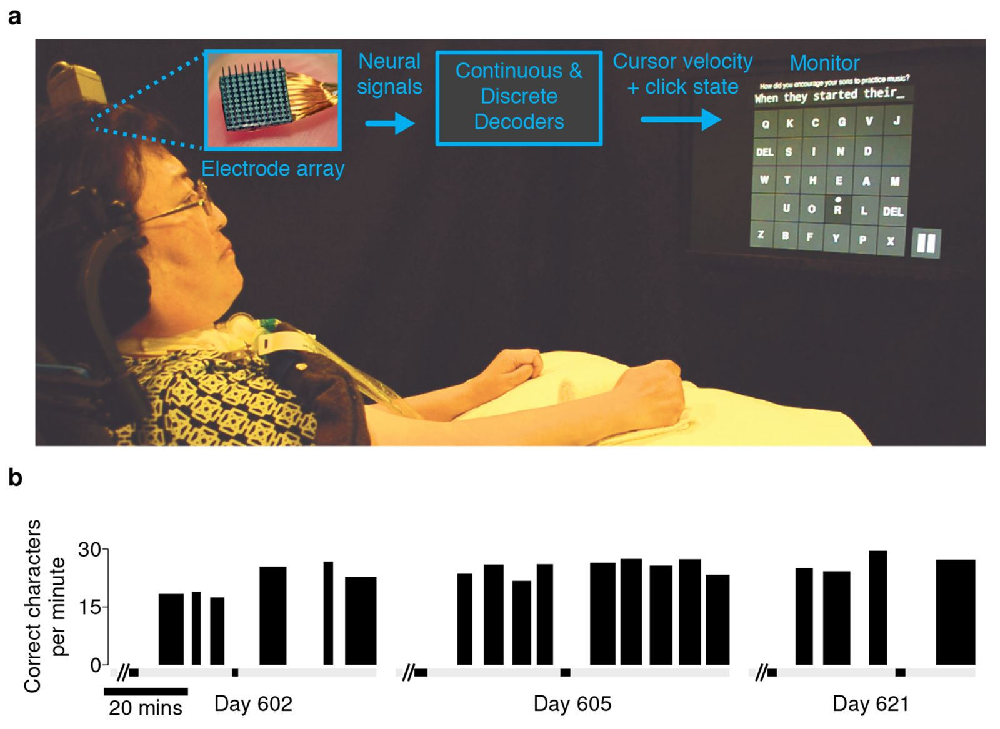
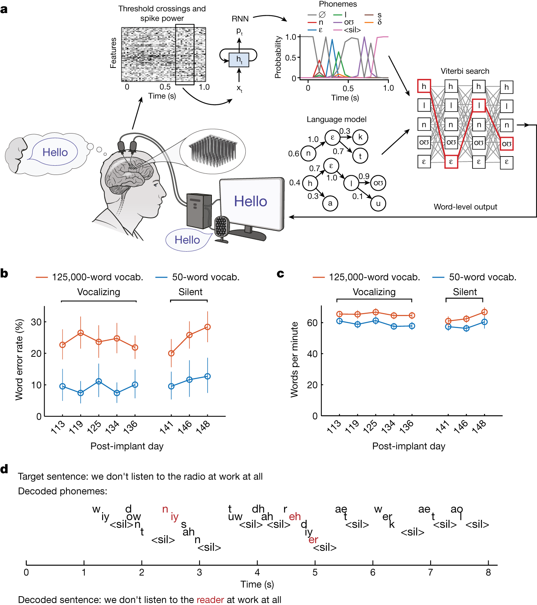
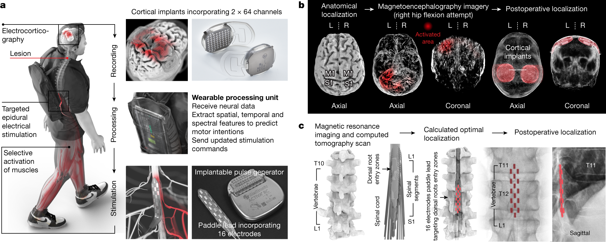
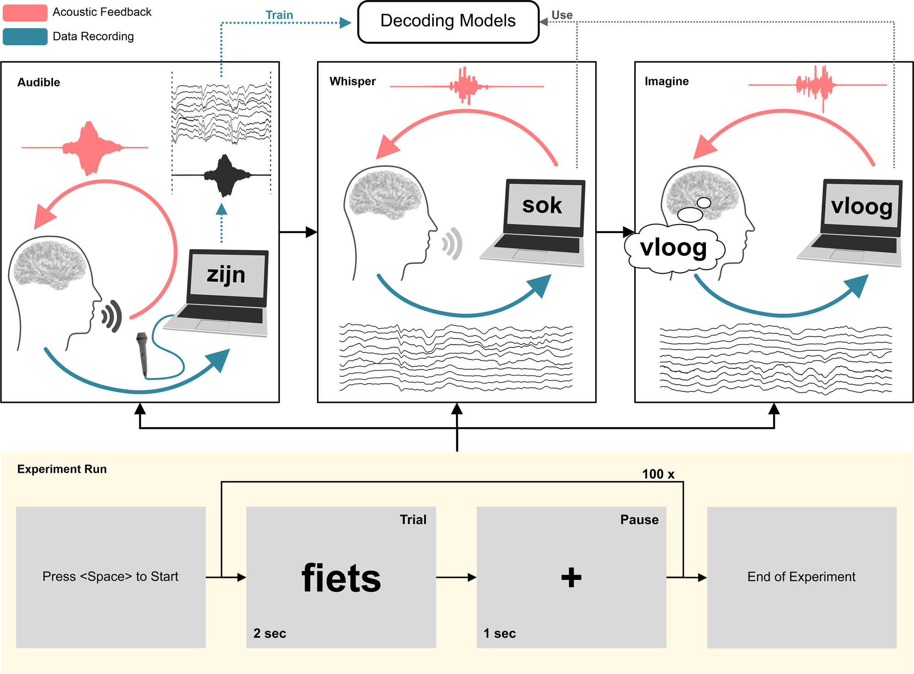
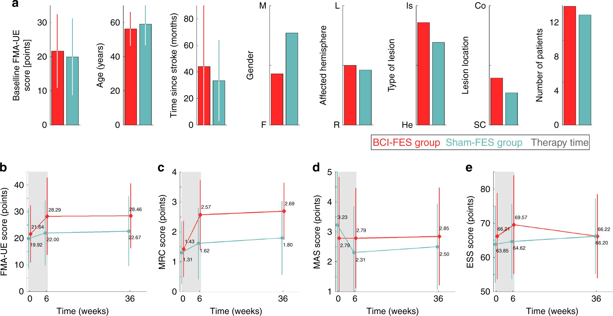
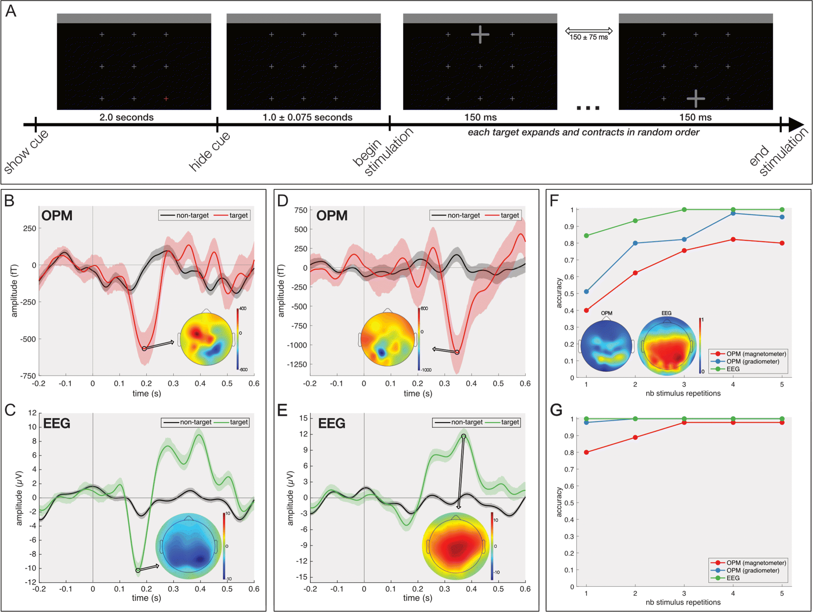

# 神经电信号：从离子电流到解码与反馈

> **审阅稿** · 2026-10-09  
> 本文按站点草稿发布，列表里还不会出现。第 3 讲已经按课堂尺度列过 spike、LFP、ECoG 和 EEG。这一篇改从生理机制写起，并为每一种信号给出一条能对上论文的研究闭环：信号如何产生，电极或传感器看到什么，解码器用什么特征，输出送到哪里，反馈又如何回到使用者。图 1–6 是这些闭环论文里可以按 CC BY 转载的原图。  
> 文中的性能数字来自所引论文的摘要或正文。多数侵入式闭环仍是单名或数名被试，段落里会标明。离线解码不会被写成已经能在家使用的通信装置。

第 1 讲把脑机接口收成四步：神经界面、神经解码、神经控制、神经反馈。这四步作用在同一种物理量上。神经元膜上的离子流过膜，细胞外液体里出现回流，电极量到的就是这个回流造成的电位。头皮脑电、皮层脑电、局部场电位和锋电位，是同一过程在不同距离、不同频段上的样子（Buzsáki、Anastassiou 与 Koch，2012）。

下面先把这条共同的物理链写清楚，再按空间尺度从近到远展开。每一种信号都按同一套问题来写。

| 环节 | 要回答的问题 |
| --- | --- |
| 产生 | 哪一类跨膜电流，在什么细胞结构上，以什么时间尺度出现 |
| 记录 | 传感器放在哪，空间上混进了多少组织，频段怎么选 |
| 特征 | 解码器实际吃进去的是发放率、频谱、相位，还是时域幅度 |
| 解码与输出 | 模型把特征映射成光标、文字、声音、肌肉刺激或脊髓刺激 |
| 反馈 | 使用者看到、听到或感觉到什么，这个感觉是否改变下一时刻的神经活动 |
| 证据边界 | 被试人数、在线还是离线、词汇或任务是否封闭 |

## 1. 共同起点：跨膜电流与容积导体

一个皮层锥体细胞接收来自其他细胞的突触电流。兴奋性突触使正离子流入树突，该部位成为电流汇（sink）；回路在细胞的另一段膜上流出，成为电流源（source）。抑制性突触把这个图案反过来。源和汇在空间上分开，就形成一个电偶极子。许多锥体细胞的顶端树突朝向皮层表面、排列整齐，这种开放电场（open field）里的电流可以相加。中间神经元的树突若向四周均匀伸展，电流在远处更容易互相抵消，对远场的贡献较小（Buzsáki 等，2012）。

细胞外电位因此主要来自突触跨膜电流。钠锋电位、钙锋电位、电压门控和配体门控通道的离子流，以及膜本身的振荡电流，也会塑造这个场。锋电位时间短、空间衰减快，近处的微电极在高通滤波之后能把它单独看出来。把同一根电极的低频留下，看到的是周围一群突触电流的混合，也就是局部场电位。电极移到软膜或硬膜上，混合范围变成毫米。再隔着脑脊液、颅骨和头皮，混合范围变成厘米，这就是头皮脑电（Buzsáki 等，2012；Nunez 与 Srinivasan，2006）。

同步决定远场能不能被看见。少量细胞各自发放，偶极子方向和时间都散，远处几乎相消。一大片细胞在几十毫秒内一起发生突触电流，远处的电极才会记下一个慢电位。这也是头皮上容易看见 α、μ、β 这类节律，却很难看见单个锋电位的原因。

磁信号走的是同一批电流的磁效应。颅骨对磁场的扭曲远小于对电位的扭曲，所以脑磁图保留了更多空间细节，代价是设备、屏蔽和径向电流源的可见性。这一点放到第 7 节。

## 2. 动作电位与 spike

### 2.1 细胞内的脉冲怎样产生

动作电位是轴突和胞体膜上一次快速、全或无的去极化。Hodgkin 与 Huxley（1952）在枪乌贼巨轴突上把膜电流拆成电容电流、钠电流和钾电流，并用电压和时间依赖的电导把发放过程定量下来。这个框架今天仍然是读 spike 的生理底稿。

静息时膜内相对膜外为负，典型锥体细胞大约在 −70 mV 附近，具体数值随细胞类型和状态变化。突触电流在树突和胞体上积分。膜电位到达阈值后，电压门控钠通道打开，钠离子内流，膜电位迅速冲向正值。钠通道很快失活，电压门控钾通道打开，钾离子外流，膜电位回到静息附近，并常有一段不应期。脉冲幅度一旦触发，就不再跟随刺激强度连续增大。刺激强度改变的是能否到达阈值，以及到达阈值的频率。

对这一个神经元来说，spike 是它的输出。输入是成千上万突触上的兴奋性和抑制性突触后电位。第 1 讲里“单个神经元的输出，加上大量突触输入”指的就是同一细胞上的这两个方向。

### 2.2 微电极为什么看到的是细胞外波形

临床和动物实验里的 spike，几乎都不是细胞内电极插进胞体记下的那条曲线。微电极停在细胞外，量到的是膜电流在细胞外液里的回流。

Gold、Henze、Koch 与 Buzsáki（2006）用线源近似，把重建的海马 CA1 锥体细胞的跨膜电流映射成细胞外电位，并与在体的胞内–胞外同步记录对照。模型能同时解释细胞外波形的形状和幅度。波形随电极相对细胞的位置改变。在他们的模型里，树突形态对细胞外波形的影响很小，不同细胞的离子电流组成则会写进波形特征里。

靠近胞体时，钠内流是局部的电流汇，细胞外电位通常先向下偏。电流从更远的膜段返回，电极若放在树突或轴突旁，波形的正负和时间关系会换一套。所以分类器看到的“一个神经元一种波形”，同时包含细胞身份、电极位置和离子电流组成。电极挪几十微米，同一个细胞的波形可以变到难以再认。

工程上因此把宽带记录做高通，常见下截止在 300 Hz 附近，再在大约 5–8 kHz 采样。阈值穿越、能量检测或模板匹配用来标出发放时刻。真正分拣到单个神经元，还要求波形稳定、信噪比足够，并能把邻近细胞分开。人体运动皮层接口里更常见的做法，是直接使用多单元活动：电压越过某个阈值就计一次，不再坚持每个波形都属于哪一个细胞。Willett 等（2021）的手写接口把每根电极的阈值设在该电极电压均方根的 −3.5 倍，再把穿越次数放进时间箱。他们明确把这当作多单元发放率，而不是分拣后的单细胞序列。Christie 等（2014）曾比较过，这种阈值穿越对接口性能可以接近分拣后的单细胞；Willett 等在方法里沿用了这一判断。

读后面的“spike 闭环”时，要把三层信号分开。

| 名称 | 实际用的量 | 空间含义 |
| --- | --- | --- |
| 单细胞 spike | 分拣后的发放时刻 | 一个神经元的输出 |
| 多单元发放（MUA） | 阈值穿越率，常混有邻近几个细胞 | 电极尖端附近的输出 |
| 尖峰频段功率 | 300 Hz 以上能量的包络，不必检测单个脉冲 | 局部发放强度的连续近似 |

三层都来自快速钠钾电流，解码器的稳定性和信息量并不相同。

### 2.3 群体如何携带运动和言语

单个运动皮层神经元的发放率随运动方向平滑变化，偏好方向附近最高。Georgopoulos、Schwartz 与 Kettner（1986）把许多细胞的偏好方向按发放率加权后相加，得到群体向量，用来估计手臂的运动方向。后来的接口很少再手写这个向量，但“方向和速度写在一群细胞的发放率里”仍是运动解码的起点。

时间结构同样有用。手写、发音这些快速技巧动作会在几百毫秒里展开成一串可区分的神经轨迹。Willett 等（2021）用这一点解释手写为何比点到点的光标更容易解码：时间模式复杂的动作，在神经群体里留下的轨迹更不容易混在一起。

言语运动皮层还保留着发音器官和音素的表示。Willett 等（2023）在一名因肌萎缩侧索硬化而不能清晰说话的被试身上看到，腹侧前运动皮层里，对不同发音器官的调谐在空间上混在一起；瘫痪多年之后，音素的发音表征仍在。这种混杂意味着一小块皮层里就同时含有多种发音信息，也意味着单看某一个电极的波形解释不了一个词。

### 2.4 闭环一：从光标和机械臂到书写

最早的单细胞闭环是操作式条件化。Fetz（1969）让猕猴通过食物奖励学会提高或降低一个运动皮层神经元的发放率。反馈是奖励，输出是发放率本身。它证明细胞活动可以被意志推动，还没有外部装置的连续控制。

连续控制依赖群体解码和在线再校准。Gilja 等（2012）在猕猴运动皮层阵列上比较解码器，提出按闭环意图重新训练的卡尔曼滤波（ReFIT-KF）。开环阶段，解码器通常拿神经活动去拟合手的真实速度。闭环之后，光标已经由神经活动驱动，动物会为了把光标送进目标而改变发放。若仍用“神经活动预测手”来训练，模型学到的是旧映射。ReFIT 把训练目标改成使用者当下想让光标去的方向，并假设到达目标后意图速度为零。在猕猴上，这个解码器把目标获取时间缩短约一半，可以连续用数小时，植入多年后仍能重复做出高性能。

人体上的对应闭环分成机械臂和通信两条。

Hochberg 等（2012）在四肢瘫痪者的运动皮层植入微电极阵列，被试用神经活动控制机械臂完成伸手和抓握，其中一名被试能够拿起瓶子喝咖啡。Collinger 等（2013）在一名四肢瘫痪者的运动皮层植入两枚 96 通道阵列，训练 13 周后，被试常规控制一台拟人假肢的七个自由度：三维平移、三维朝向和一维抓握。基于目标的到达任务平均成功率为 91.6%（标准差 4.4），机会水平的中位数是 6.2%。这是读出的闭环：视觉看到假肢，运动皮层的下一次发放跟着这个视觉误差改。

同一名后来参与手写研究的被试，早先用点选光标达到过每分钟 39 个正确字符（Pandarinath 等，2017；Willett 等，2021 的对照）。

**图 1.** Pandarinath 等（2017）图 1。a：被试 T6，运动皮层上的阵列把神经信号送进连续解码器和离散解码器，输出光标速度和点击，屏幕上是点选键盘。b：植入后第 602、605、621 天若干段记录的每分钟正确字符数；图上的柱高低于正文所引的每分钟 39 个正确字符，39 是论文报告的较高成绩，不在这三天的柱上。许可：CC BY。[10.7554/eLife.18554](https://doi.org/10.7554/eLife.18554)

Willett 等（2021）改解手写。两枚各 96 通道的阵列放在运动皮层手区，特征是 −3.5 倍均方根阈值的多单元穿越率。循环神经网络把尝试书写的神经轨迹转成字符。在线抄写达到每分钟 90 个字符、原始正确率 94.1%；离线加上通用自动纠正后，正确率超过 99%。反馈是屏幕上逐字出现的文本。被试的手已因脊髓损伤瘫痪，解码的是尝试书写时运动皮层仍在产生的活动。

### 2.5 闭环二：尝试说话，以及把触觉写回去

Willett 等（2023）把记录从手区换到言语相关的皮层内阵列，被试是不能清晰发声的肌萎缩侧索硬化患者。在线解码尝试说话：出声尝试时，50 词词表的词错误率 9.1%，125 000 词词表的词错误率 23.8%；只做口型、不发声时分别为 11.2% 和 24.7%。速度是每分钟 62 个词。论文把日常对话的参照速度写为每分钟约 160 词。反馈是解码出的文字。神经活动来自尝试说话，语言模型只在音素序列之后做约束；论文报告，循环网络在加上语言模型之前已经能给出可理解的音素串，音素错误率在出声条件下为 19.7%。

**图 2.** Willett 等（2023）图 2。a：阈值穿越和尖峰功率送进循环网络，得到音素概率，再和语言模型一起做维特比搜索，输出词。b、c：出声尝试和只做口型时，50 词与 125 000 词两种词表的词错误率和每分钟词数，横轴是植入后天数。d：目标句 “we don't listen to the radio at work at all” 被解成 “reader”。许可：CC BY。[10.1038/s41586-023-06377-x](https://doi.org/10.1038/s41586-023-06377-x)

Card 等（2024）把同一路线推进到更短的校准和更长的使用。一名 45 岁、四肢轻瘫且严重构音障碍的肌萎缩侧索硬化患者，在左侧腹侧中央前回植入四枚阵列，共 256 个皮层内电极。术后第 25 天第一次使用，30 分钟尝试说话的记录之后，50 词词表正确率 99.6%。第二天再采集 1.4 小时、260 个句子，词表扩到 125 000 词，抄写任务词错误率 9.8%，即正确率 90.2%。继续积累数据后，植入后 8.4 个月仍维持在大约 97.5% 的正确率。最后五个评估日的平均词错误率为 2.5%（95% 置信区间 2.0–3.1），自定步速每分钟 31.6 词。解码文字显示在屏幕上，再用接近他患病前声音的语音合成读出来。截至论文报告时，自主对话累计超过 248 小时。这条闭环里，反馈同时是视觉文本和听觉语音。速度低于 Willett 等（2023）的 62 词/分钟，错误率和使用时长走的是另一组设计目标。两个研究各有一名主要被试，不能直接看成同一套设备的前后版本。

只把运动指令送出去，抓握仍然慢，因为视觉对“手是否已经接触物体”不敏感。Flesher 等（2021）在一名颈髓损伤患者身上同时读运动皮层、写躯体感觉皮层。机器人手指上的接触和握力传感器实时驱动 1 区的皮层内微刺激，被试感觉来自自己的手掌和手指。临床上肢评估的试次中位时间从 20.9 秒降到 10.2 秒，节省的时间主要来自更少的反复抓取。这里的反馈不再只是眼睛看机械臂，而是人工触觉写进体感皮层。

### 2.6 这条闭环还不稳定的地方

锋电位和多单元活动给出了目前最高的运动与言语通信率，也最依赖电极和细胞的距离。胶质瘢痕、微动和阻抗漂移会让可分拣的波形消失。Gilja 等展示的是解码器可以按闭环意图重学；Flint、Wright、Scheid 与 Slutzky（2013）则指出，许多单细胞解码器若不经常重训练，性能会随时间下降。他们在猕猴上改用局部场电位和多单元发放，正是为了绕开这个衰减。下一节的证据从这里接上。

Card 等（2024）和 Willett 等（2021、2023）都是单名被试、特定植入部位和大量研究者在场校准。248 小时说明日常使用已经开始，还不是一项多中心疗效试验。

## 3. 局部场电位 LFP

### 3.1 它主要反映突触电流，范围却不固定

局部场电位是皮层内或核团内电极记下的低频细胞外电位。Einevoll、Kayser、Logothetis 与 Panzeri（2013）把讨论范围放到大约 500 Hz 以下。它不是“把许多 spike 加在一起再滤一滤”这么简单。Buzsáki 等（2012）把突触电流写成细胞外信号的主要来源，同时强调钠钙锋电位、电压依赖电流和膜振荡都会进入这个频段。高频段里，邻近神经元的同步发放会成为局部场的重要成分。

因此 LFP 更靠近一个局部网络的输入和局部加工，spike 更靠近个别细胞的输出。两者相关，却不是同一个量的两种滤波。Logothetis、Pauls、Augath、Trinath 与 Oeltermann（2001）在猕猴视觉皮层比较过血氧水平依赖信号、多单元发放和 LFP：血氧信号与 LFP 的关系比与单细胞发放更紧密。这给“场电位看群体突触活动，发放看输出”提供了一个跨测量的对照，也说明功能磁共振不能直接换成发放率。

“局部”的半径没有一个通用毫米数。视皮层的一些估计把有效整合范围收到数百微米。Kajikawa 与 Schroeder（2011）在猕猴初级听觉皮层比较 LFP、电流源密度和多单元活动，空间选择性从多单元到电流源密度再到 LFP 依次变差；他们测到场电位可以被动扩散到距离起源超过 1 cm 的位置，而且这种扩散不限于某一个频段。Einevoll 等（2013）综述的建模则说明，突触输入若在空间上相关，场电位的有效范围会进一步变大。读 LFP 解码论文时，一根电极的“局部”要连同皮层区域、层位、频段和同步程度一起看。

### 3.2 解码时常用的特征

运动接口里，LFP 至少有两类可用特征。

一类是频段功率。运动准备和执行时，β 功率常下降，γ 功率上升，停下来之后 β 又会反弹。这和头皮上的事件相关去同步是同一族现象，只是电极在皮层内，空间混合更少（Pfurtscheller 与 Lopes da Silva，1999）。

另一类几乎不进入频谱。局部运动电位（local motor potential，LMP）是 LFP 的低频时域幅度，可以理解成一条慢的、随运动方向偏移的电压。Stavisky、Kao、Nuyujukian 等（2015）在两只猕猴的初级运动皮层和前运动皮层记录，比较 LMP、其他 LFP 特征和 spike。离线重建速度时，LMP 是唯一能在两只动物里接近 spike 的场电位特征：一只动物上 LMP 与速度的相关为 0.78 ± 0.010，spike 为 0.73 ± 0.022；另一只为 0.77 ± 0.005 对 0.80 ± 0.032。两者相加，离线相关进一步升高。

### 3.3 闭环：不重训练的光标，以及和 spike 合用

Flint 等（2013）把 LFP 放进在线光标控制。两只猕猴的初级运动皮层植入微电极，生物拟态解码器把 LFP 或未分拣的多单元发放映射成光标速度。LFP 解码器在不重训练、不自适应的条件下，连续控制保持稳定或继续变好，时间接近 12 个月。多单元发放的在线控制在六个多月里大体稳定。同一时期，若用这些信号离线预测手的运动，映射却明显漂移。在线稳定和离线漂移同时存在，说明动物在闭环里把“神经活动到光标”这条映射稳住了，这条映射不必等于“神经活动到手”。

Stavisky 等（2015）接着做了在线对比。单独用 LMP 就能快速、准确地控制光标，性能超过此前报告的 LFP 接口。spike 质量中等或较差时，LMP 与 spike 一起解码比只用 spike 更好。LMP 的提取只需要低通，算力和功耗都低于锋电位检测。论文的直接结论是：阵列上的 spike 变少之后，低频场电位可以补上或顶上，从而延长接口还能用的时间。

深部核团里的场电位把这条闭环推进到了日常治疗。Oehrn 等（2024）在四名帕金森病患者中做了一项盲法、随机交叉的可行性试验，比较自适应脑深部刺激和已经调好的持续刺激。他们没有预先指定丘脑底核 β 作为控制信号，而是在刺激打开时搜索与药效和残留运动症状相关的场电位。四名患者里，最优标记都落在丘脑底核或感觉运动皮层中、被刺激夹带的 γ 振荡，大约 65–70 Hz。用这个信号调节刺激幅度后，日常活动中的运动症状和生活质量优于持续刺激。样本量是四名男性患者、可行性设计。它说明深部场电位已经能在人身上关闭“记录 → 症状标记 → 刺激幅度 → 运动状态”这一环，也说明最优频段不一定是教科书上的 β。

### 3.4 证据边界

Flint 与 Stavisky 的在线光标是猕猴。人体运动假肢的主结果仍然来自多单元 spike。Oehrn 等把人身上的场电位闭环做进了治疗，控制对象是刺激参数，不是计算机光标；皮层那一路信号来自与深部电极配套的皮层记录，空间尺度已经接近下一节的皮层表面电极。

## 4. 皮层脑电图 ECoG

### 4.1 软膜或硬膜上的同一类电流

皮层脑电图把电极放在硬膜下的软膜表面，或放在硬膜外。它记录的仍是跨膜电流在细胞外的电位，只是每个触点平均了一小片皮层，并失去了单细胞波形（Buzsáki 等，2012）。

临床网格的触点直径常为数毫米，间距约 1 cm。高密度科研阵列把间距收到 3–4 mm，触点直径收到 1–2 mm。硬膜外阵列和硬膜下阵列看到的是同一类皮层电流，硬膜会再低通、再衰减一次。Lorach 等（2023）使用的 WIMAGINE 明确放在硬膜外：直径 50 mm 的钛壳取代骨瓣，内侧面有 64 个铂铱电极，电极直径 2 mm，间距 4–4.5 mm。输入参考噪声在 0.5–300 Hz 内低于 0.7 μV 均方根。

### 4.2 高 gamma 与宽带功率

头皮运动想象主要看 μ 和 β 的功率下降。ECoG 多出来的、也最有用的，是 70 Hz 以上的高 gamma，以及一种跨很宽频段的功率抬升。

Crone、Miglioretti、Gordon 与 Lesser（1998）在硬膜下电极上观察到，感觉运动皮层在运动任务中出现高 gamma 事件相关同步。它比 α、β 的事件相关去同步更贴近任务的时间和部位。颅骨本身像一个低通，头皮肌电又落在 gamma 频段，所以这一现象在头皮上很难干净地看见。

Miller、Zanos、Fetz、den Nijs 与 Ojemann（2009）在 10 名做手指运动的病人身上，用主成分式的分解把 40 Hz 以下的窄带节律和一条 5–200 Hz 的宽带变化分开。窄带功率下降分布较广；宽带变化在空间上能分开不同手指，时间上能跟上各指的运动轨迹。此后许多 ECoG 接口说的“高 gamma”，在解释上应留一条退路：它常常是这条宽带抬升在高频段的可见部分，而不一定是一个相位锁定的 80 Hz 振荡。

低频谱、μ/β 去同步和高 gamma 可以同时进入解码器。Littlejohn 等（2025）的流式语音合成同时使用高 gamma 和低频信号。Lorach 等（2023）绘制下肢意图时，检查了 0.5–10 Hz、10–40 Hz、40–100 Hz 和 100–200 Hz 几个频段的空间权重。

### 4.3 闭环一：家里的点击，和走路

Vansteensel 等（2016）报告了一名晚期肌萎缩侧索硬化、处于闭锁状态的患者。四条硬膜下条状电极经钻孔放在手部运动皮层，另有前额叶作为备份；每条四个电极，电极直径 4 mm，间距 1 cm。发射器埋在左胸皮下，系统全部植入。患者通过尝试活动对侧的手，在电极植入 28 周后独立控制打字程序，速率相当于每分钟两个字母。这个接口在家里使用，有时补充、有时替代眼动仪。反馈是屏幕上的字母选择。速率远低于后来的高密度阵列，闭环的意义在于：硬膜下场电位、皮下发射器和自主使用可以同时成立。

Lorach 等（2023）把硬膜外 ECoG 接到脊髓。一名慢性四肢瘫痪者接受双侧植入，两枚 WIMAGINE 覆盖左右感觉运动皮层中与下肢意图相关的区域。术前用脑磁图和解剖影像定位。无线感应供电，数据经 402–405 MHz 发出。受带宽限制，每枚植入体实际采集 32 个通道，采样率 586 Hz，带通 1–300 Hz。

**图 3.** Lorach 等（2023）图 1。a：左右各 64 通道的硬膜外记录，经可穿戴处理器换成脊髓刺激指令；刺激电极有 16 个触点。b：解剖定位之后，脑磁图标出尝试屈曲右髋时的激活，术后影像显示两枚皮层植入的位置。c：刺激电极对准腰骶脊髓的背根入口区，术后矢状位对照计划位置。许可：CC BY。[10.1038/s41586-023-06094-5](https://doi.org/10.1038/s41586-023-06094-5)

解码分两层。空间、频谱和时间特征先送进一个门控模型，判断休息以及左右髋、膝、踝这七个状态；状态序列用一阶隐马尔可夫假设，发射概率来自线性判别。七状态的准确率为 74% ± 7%，机会水平 14%，解码延迟低至 1.1 秒（标准误 0.15 秒）。状态概率再连续调节硬膜外脊髓刺激的幅度，刺激打在与承重、推进和摆动相应的腰骶脊髓区域。

反馈分成两段。手术后第一次会话，被试已经能控制屏幕上化身的左右髋屈曲。随后刺激接入，仰卧位不到两分钟，控制髋屈肌力矩的准确率达到 97%。走到社区环境后，反馈就是自己的腿：站立、行走、上下楼梯和复杂地面。论文报告校准可以在几分钟内完成，可靠性在一年内保持，包括在家独立使用。康复之后，关掉这个脑–脊接口，被试仍能靠拐杖在地面行走。这是目前最完整的 ECoG 运动闭环之一，证据仍来自一名被试。信号质量方面，静息功率在近一年里大约每天下降 0.03 dB，作者将其描述为很小。

### 4.4 闭环二：从 50 个词到边说边合成

Moses 等（2021）在一名脑干卒中后构音不能、四肢痉挛性瘫痪的被试身上，把高密度硬膜下阵列放在控制言语的感觉运动皮层。被试尝试说一个 50 词词表里的词，累计 22 小时、48 次会话。深度学习模型检测并分类词语，自然语言模型提供下一个词的概率。在线句子解码的中位速度为每分钟 15.2 词，中位词错误率 25.6%。事后分析里，单个词的尝试被检出 98%，词分类正确率 47.1%，皮层信号在 81 周内保持可用。反馈是实时出现的句子。

Metzger 等（2023）使用 253 通道硬膜下阵列，把输出从文字扩成三种：文字、语音和面部化身。被试尝试无声说话，训练不足两周。文字解码的中位速度为每分钟 78.3 词（99% 置信区间 75.5–79.4），中位词错误率 25%。语音合成对准患病前的声音，化身则跟随口面部的言语和非言语表情。反馈第一次同时占据视觉和听觉，并且带着说话人的面部运动。

Littlejohn 等（2025）去掉“等一句话说完再解码”的等待。同一临床试验（NCT03698149）中，这名脑干卒中后严重瘫痪、构音不能的被试植入 253 通道硬膜下阵列，触点中心距 3 mm，记录触点直径 1 mm，覆盖左侧中央前、后回以及部分颞上回。循环神经网络转导器每 80 ms 吃入一段神经活动，同时吐出个性化语音和文本。在线时，合成语音从扬声器播放，文字显示在屏幕上。

1024 词的一般句集上，中位速度每分钟 47.5 词，从检出的说话尝试到语音出现的中位延迟 1.12 秒；听写员给出的语音词错误率中位数 58.8%，文本词错误率中位数 31.9%。50 句的封闭沟通句集上，中位速度每分钟 90.9 词，语音词错误率中位数 12.3%，文本词错误率中位数 10.3%。封闭句集更快，部分是因为尝试说话的速度被任务设计得更快。80 ms 分块本身的计算延迟中位数只有 11.83 ms。论文把长时、不按试次切断的检测放在离线分析里：模型可以在休息时保持安静，并在说话开始后连续合成。反馈已经是边尝试边听见的声音；开放词表上的可懂度仍明显低于封闭句集。

这三篇出自同一临床试验（NCT03698149）。Moses 等（2021）是这条线上较早的句子解码。Metzger 等（2023）和 Littlejohn 等（2025）使用后来植入的 253 通道硬膜下阵列，先把文字、声音和化身一起做出来，再把声音变成连续流。它们不是三个独立队列的重复验证。

### 4.5 证据边界

ECoG 的闭环已经包括家庭打字、社区行走和流式语音。空间分辨率停在毫米到数毫米，单细胞发放不可见。高密度阵列目前仍常通过经皮连接座把信号送出来，完全植入的无线系统在行走研究里已经实现，言语研究的 253 通道阵列则还带着连接座。Vansteensel 的全植入系统换来的是每分钟两个字母。通道数、无线带宽和植入体积是同一组约束。

## 5. 立体定向脑电图 sEEG

立体定向脑电图把细的深度电极从颅骨小孔送入，触点沿电极杆分布在皮层和深部结构里。它是癫痫定位的临床工具，研究记录通常发生在监测室内，电极位置由致痫区而不是由接口设计决定。信号本身仍是细胞外场电位，频段覆盖慢电位到高 gamma，空间尺度介于皮层内 LFP 和表面 ECoG 之间：一个触点看一小段接触到的灰质或白质，一根电极可以穿过多个区。

### 5.1 闭环的第一步：实时合成，但还听不懂

Angrick、Ottenhoff、Herff 等（2021）在一名植入 sEEG 的被试身上做了开环采集和闭环合成。开环数据训练模型，闭环时把解码出的声音实时放给被试。第一轮是气声，第二轮是想象说话、不发声也不动发音器官。因为反馈是实时的，解码不能靠事后的声音泄漏来取巧。想象说话条件下，解码波形与参考发音的动态时间弯曲相关为 0.32 ± 0.26，高于打乱后的 0.17 ± 0.22，也低于气声条件。论文写明重建的声音还不能听懂。模型主要依赖额叶活动，提示出声、气声和想象分享一部分表征。

**图 4.** Angrick 等（2021）图 1。上：出声（audible）、气声（whisper）和想象（imagine）共用解码模型。红线是声音反馈，蓝线是神经记录；想象条件下没有麦克风。下：一次实验先出词 2 秒，再停 1 秒，重复 100 次。图上的荷兰语词是实验材料。许可：CC BY。[10.1038/s42003-021-02578-0](https://doi.org/10.1038/s42003-021-02578-0)

这条闭环闭合在“神经活动 → 声音 → 耳朵”，没有闭合在“听得懂的对话”。它的价值是把 sEEG 推进到了在线反馈，并单独测试了想象言语。

### 5.2 更大的样本：音素可以跨人迁移，试验仍是离线的

Singh、Thomas、Li、Hickok、Pitkow 与 Tandon（2025）在 25 名接受 sEEG 监测的患者中记录绕口令，使用超过 3600 个深度电极触点，论文图注中的纳入电极数是 3641。任务要求患者真的把绕口令说出来。序列到序列模型从发音期间的神经活动解码音素，中位音素错误率 27%（标准差 6%）；从发音开始之前的活动解码，中位音素错误率 34%（标准差 6%）。线性模型的音素正确率只有 24%（标准差 5%）。拿掉腹侧感觉运动皮层或颞叶的电极，性能明显下降。

他们随后训练一个跨被试共享的循环层，再迁移到没参加训练的人。对感觉运动皮层覆盖不足的被试，群体模型降低了音素错误率。这是“记录 → 特征 → 解码”的群体证据，说明 sEEG 的稀疏、因人而异的覆盖可以用别人的数据补一部分。它不是瘫痪者的在线通信试验，也没有把音素串闭环成对话。论文摘要开头对“实时可懂言语”的描述，指的是这一领域里其他接口已经做到的事；本实验的终点是监测室内的音素错误率。

### 5.3 证据边界

sEEG 的手术创伤低于大片开颅，电极却不按通信皮层来排。目前能展示的完整闭环是实时但不可懂的声音；可迁移的音素解码是离线的、来自仍能说话的癫痫监测患者。把它写成已经具备 ECoG 或皮层内电极那种通信性能，证据不够。

## 6. 头皮脑电 EEG

### 6.1 容积导体把细节抹平

头皮电极看到的，是大片开放电场经过脑脊液、硬膜、颅骨和头皮之后的电位。颅骨电导率低，空间上相当于一次强烈的低通和模糊（Nunez 与 Srinivasan，2006；Buzsáki 等，2012）。单个突触和单个锋电位到不了头皮。能到的，是数平方厘米皮层上同步发生的突触电流。

实用上，脑电接口用三类时间锁定方式不同的特征。

事件相关去同步和同步不要求电位与事件逐拍对齐。Pfurtscheller 与 Lopes da Silva（1999）把功率下降定义为事件相关去同步，功率上升定义为事件相关同步。手的运动或运动想象时，对侧感觉运动区的 μ（约 8–13 Hz）和 β（约 13–30 Hz）功率下降；动作结束后 β 常短暂回升。运动想象接口用的就是这个功率变化。它和事件相关电位不同，不能靠试次平均把波形叠出来。

P300 是对稀有目标刺激的正向偏转，大约出现在刺激后 300 ms。Farwell 与 Donchin（1988）用它做了经典的脑电拼写：注意某一个字母，行列闪烁中包含该字母的刺激引出更大的 P300。Chen 等（2015）回顾这条路线时，把它的通信率概括为大约每分钟五个字母、约 0.5 bit/s。

稳态视觉诱发电位是另一条。视野里以固定频率闪烁的目标，会在枕叶和相关导联上诱发出同频率及其谐波的振荡。使用者用目光选择目标，解码器识别频率和相位。

### 6.2 闭环一：注视一个闪烁键盘

Chen、Wang、Nakanishi、Gao、Jung 与 Gao（2015）用联合频率–相位调制，在 0.5 秒的闪烁里区分 40 个字符，再用每个人自己的校准数据和滤波器组典型相关分析解码。在线自由拼写中，12 名健康被试的平均速度为每分钟 50.83 ± 11.64 个字符，信息传输率 4.50 ± 1.03 bit/s；其中多人在 0.5 秒刺激加 0.5 秒转移注视的设置下达到每分钟 60 字符、5.32 bit/s。论文把它写成当时脑电拼写报告过的最高传输率之一。

反馈是字符出现在屏幕上。闭环成立，而且是健康人、需要把目光移到目标上的闭环。对眼动已经丧失的人，这条路线的前提不在。传输率也不能直接和皮层内言语接口的词错误率比较：任务、词表、使用者和错误定义都不同。

### 6.3 闭环二：意图到来的那一下，才刺激肌肉

康复接口的输出不是字符，而是自己的肌肉。Biasiucci、Leeb、Millán 等（2018）纳入 27 名慢性卒中患者，14 人接受脑电触发的功能性电刺激，13 人接受刺激时间不与脑电意图锁定的假刺激。两组都做伸手侧手指和手腕的尝试。只有脑电组在干预后出现达到论文所设临床阈值的上肢功能变化：Fugl-Meyer 上肢评分增加 6.6 ± 5.6 分，论文采用的临床相关阈值是 5 分。增益在治疗结束后 6–12 个月仍在。脑电分析显示，患侧运动区间的功能连接增加，并且与功能改善相关。

这里的反馈是躯体自己的：大脑做出伸展尝试，解码器在这个尝试发生时打开电刺激，肌肉收缩，感觉再返回大脑。假刺激组接受相似的电流，缺少的是这时间上的锁定。论文的结论因此落在配对，而不是落在“电刺激本身有益”。入组是按顺序分配到两组，不是大型双盲随机试验；27 人、慢性期、中重度上肢障碍，是它的外推范围。

**图 5.** Biasiucci 等（2018）图 1。a：两组的基线 Fugl-Meyer 上肢评分、年龄、病程、性别、病灶侧和病灶类型。b：BCI-FES 组的 FMA-UE 从 21.64 分到第 6 周的 28.29 分，第 36 周仍是 28.46 分；假刺激组从 19.92 分到 22.67 分。c–e 是肌力、痉挛和另一项评分，变化小于 FMA-UE。许可：CC BY。[10.1038/s41467-018-04673-z](https://doi.org/10.1038/s41467-018-04673-z)

### 6.4 证据边界

脑电可以重复使用，不需要手术。空间尺度停在厘米，肌电、眼动和工频往往比脑电更大。运动想象的通信速率通常低于稳态视觉诱发电位，也不依赖注视。稳态视觉诱发电位的高速率来自健康人的目光和短时闪烁。康复闭环表明，厘米级的感觉运动节律已经足够触发一次与意图锁定的肌肉刺激，并在一项对照研究里留下持续数月的行为变化。

## 7. 脑磁图 MEG

神经元的跨膜电流在头外产生极弱的磁场。超导量子干涉器件把这个磁场测出来，时间分辨率仍是毫秒。和脑电相比，磁场较少被颅骨模糊，所以传感器上的空间图案更接近皮层上的电流图案。径向朝外的电流在头外产生的磁场很弱，脑磁图对切向电流更敏感（Hämäläinen、Hari、Ilmoniemi、Knuutila 与 Lounasmaa，1993）。

Mellinger、Schalk、Kübler 等（2007）把感觉运动 μ 和 β 的幅度调制做成在线接口。六名被试通过肢体运动想象传达二选一的决定，反馈训练 32 分钟内达到显著的 μ 节律自我控制。其中三人的调制来源被定位到运动皮层。反馈是任务里的二选一结果。这条闭环证明脑磁图可以完成和脑电运动想象同一类的在线控制，训练可以很短。设备仍是屏蔽室内的固定头盔，被试不能自由走动。论文没有证明空间分辨率会自动变成更高的通信速率。

Boto 等（2018）换成室温工作的光泵磁强计，做成可戴的头盔，并用主动场抵消代替对被试静止的要求。被试在点头、伸展、喝水和玩球时仍能记到毫秒级的神经磁信号。这解决的是传感器和运动伪迹，不是一个已经完成的通信或康复闭环。可穿戴脑磁图若要变成接口，还要把 Mellinger 那种在线解码放进这个新硬件里，并在目标使用者身上重复。

Wittevrongel 等（2021）做的就是光泵传感器上的在线解码，任务不是运动想象，而是注视按伪随机顺序放大、缩小的视觉目标。Mellinger 的运动想象原图在 NeuroImage，这里不转载。

**图 6.** Wittevrongel 等（2021）图 1。A：各目标以 150 ms 量级的间隔随机放大、缩小。B–E：光泵磁强计和脑电上，目标与非目标的波形及地形图。F、G：磁强计、梯度计和脑电的正确率随刺激重复次数上升。这不是 Mellinger 等（2007）的运动想象实验。许可：CC BY。[10.1186/s12915-021-01073-6](https://doi.org/10.1186/s12915-021-01073-6)

## 8. 另外三条经常一起出现的信号

主题是神经电活动。脑机接口文献里还有三条信号会和上面的电极混在同一篇综述里：血管内记录到的皮层场电位、周围神经和肌肉的电活动，以及根本不是电的血氧信号。前两条仍是生物电，第三条用来划清边界。

### 8.1 血管内场电位

支架电极从静脉进入上矢状窦，贴着血管壁记录邻近皮层的场电位。它不刺入脑实质，看到的仍是皮层群体电流，空间尺度接近较粗的硬膜外记录。Oxley 等（2016）在绵羊里把这条路径的慢性记录做出来。Mitchell 等（2023）报告 SWITCH 研究的前四名严重瘫痪患者：全植入、无线传输，用运动相关的血管内信号控制计算机上的开关。安全性是这篇人体论文的主要终点。反馈是屏幕上的开关动作。通道数少，闭环的任务也比前面的句子解码简单。它补上的是“场电位可以用血管内手术送到体外”这一环。

### 8.2 肌肉电和周围神经电

表面肌电记录的是肌纤维动作电位经过皮肤后的混合，不是皮层电流。它在假肢控制里非常成熟，也常作为脑电接口的对照或混合通道：人还能剩余一点肌肉时，肌电往往比头皮脑电更直接。Littlejohn 等（2025）把同一套流式语音架构用到表面肌电和皮层内电极上，并明确写了这是架构的可迁移性测试；记录方式、训练量和病因都不同，论文自己不做跨模态的性能排名。

周围神经的电信号是轴突的细胞外电位，生理上就是第 2 节的锋电位传到了外周。套状电极、神经内电极可以读运动指令，也可以把感觉写回去。那是另一类接口，电极不在脑内。本文不把外周神经的感觉反馈试验展开成独立闭环。

### 8.3 血氧信号

功能磁共振和近红外脑功能成像记录的是血流和血红蛋白，不是离子电流。神经活动先改变局部耗氧和血管反应，信号在秒级才上升。Logothetis 等（2001）的工作把血氧信号和 LFP 连在一起，也标出了它和 spike 的差别。它们可以回答“哪一块组织更活跃”，不能回答“这一毫秒哪一个细胞发放”。第 3 讲已经写过记录层面的对比，这里不再做第二条解码闭环。

## 9. 放在一张表里

| 信号 | 主要生理来源 | 传感器位置 | 一条已核对的闭环 | 闭环终点 | 证据边界 |
| --- | --- | --- | --- | --- | --- |
| 单细胞 / 多单元 spike | 钠钾锋电位的细胞外回流 | 皮层内微电极 | Card 等，2024 | 文字和患病前声音，自定步速约 32 词/分钟 | 一名被试，256 电极 |
| 同上，书写 | 运动皮层手区的多单元发放 | 两枚 96 通道阵列 | Willett 等，2021 | 每分钟 90 字符，在线原始正确率 94.1% | 一名被试 |
| 同上，双向 | 运动皮层发放；体感皮层接受微刺激 | 运动与体感阵列 | Flesher 等，2021 | 抓取时间中位数减半 | 一名被试 |
| LFP | 突触电流为主，混有发放和内在电流 | 皮层内或深部电极 | Flint 等，2013；Stavisky 等，2015 | 猕猴光标，近一年不重训练 | 动物 |
| 深部场电位 | 核团或皮层的同步突触电流 | 丘脑底核 / 皮层电极 | Oehrn 等，2024 | 自适应刺激优于持续刺激 | 四名患者，可行性 |
| ECoG，运动 | 毫米级皮层群体电流，含高 gamma 与宽带 | 硬膜外 WIMAGINE | Lorach 等，2023 | 社区行走，一年可用 | 一名被试 |
| ECoG，言语 | 言语感觉运动皮层的高 gamma 与低频 | 硬膜下高密度阵列 | Moses 2021；Metzger 2023；Littlejohn 2025 | 从 15 词/分钟到流式语音 | 同一试验；后两篇为 253 通道阵列 |
| sEEG | 深度触点附近的场电位 | 立体定向深部电极 | Angrick 等，2021 | 实时声音，尚不可懂 | 一名被试；Singh 等 2025 为离线 |
| EEG，通信 | 大片同步突触电流 | 头皮 | Chen 等，2015 | 健康人最高约 60 字符/分钟 | 需要注视，不是瘫痪队列 |
| EEG，康复 | 感觉运动节律的功率变化 | 头皮 | Biasiucci 等，2018 | 上肢评分 +6.6 分，维持 6–12 个月 | 27 人，顺序分配 |
| MEG | 同一电流的磁场 | 头盔内传感器 | Mellinger 等，2007 | 32 分钟内做出二选一 | 六名健康被试，固定设备 |
| 血管内场电位 | 邻近皮层的群体电流 | 上矢状窦内支架 | Mitchell 等，2023 | 计算机开关 | 四名患者，以安全性为主 |

## 10. 读这张表时可以记住的三件事

第一，尺度变大时，失去的是细胞身份，留下的是同步。spike 能把一个或几个细胞的输出时间留下来。LFP、ECoG、sEEG 和 EEG 依次把更多突触电流混进同一个数。高 gamma 和宽带功率是混在一起之后仍然局部的那一部分，所以它们在 ECoG 上特别有用，到了头皮就弱。

第二，闭环会改写神经活动与输出的关系。Flint 等（2013）的在线光标可以稳定，而离线的手部预测在漂移。Gilja 等（2012）因此把解码器训练成“现在想让光标往哪去”，而不是“刚才手的速度是多少”。只做离线相关，看不到这一层。

第三，反馈通道决定任务能有多自然。屏幕文字、合成语音、化身口型、机器人触觉、脊髓刺激引起的迈步、脑电锁定的肌肉收缩，是不同的写入方式。Flesher 等把触觉写进体感皮层之后，省下的是抓取时间。Lorach 等把下肢意图写成脊髓刺激之后，反馈最终是自己的腿。Biasiucci 等表明，刺激若与脑电意图不对齐，同样的电流给不出同样的康复变化。

## 参考文献

- Angrick, M., Ottenhoff, M. C., Diener, L., Ivucic, D., Ivucic, G., Goulis, S., Saal, J., Colon, A. J., Wagner, L., Krusienski, D. J., Kubben, P. L., Schultz, T., & Herff, C. (2021). Real-time synthesis of imagined speech processes from minimally invasive recordings of neural activity. *Communications Biology, 4*, 1055. https://doi.org/10.1038/s42003-021-02578-0
- Biasiucci, A., Leeb, R., Iturrate, I., Perdikis, S., Al-Khodairy, A., Corbet, T., Schnider, A., Schmidlin, T., Zhang, H., Bassolino, M., Viceic, D., Vuadens, P., Guggisberg, A. G., & Millán, J. d. R. (2018). Brain-actuated functional electrical stimulation elicits lasting arm motor recovery after stroke. *Nature Communications, 9*, 2421. https://doi.org/10.1038/s41467-018-04673-z
- Boto, E., Holmes, N., Leggett, J., Roberts, G., Shah, V., Meyer, S. S., Muñoz, L. D., Mullinger, K. J., Tierney, T. M., Bestmann, S., Barnes, G. R., Bowtell, R., & Brookes, M. J. (2018). Moving magnetoencephalography towards real-world applications with a wearable system. *Nature, 555*, 657–661. https://doi.org/10.1038/nature26147
- Buzsáki, G., Anastassiou, C. A., & Koch, C. (2012). The origin of extracellular fields and currents — EEG, ECoG, LFP and spikes. *Nature Reviews Neuroscience, 13*(6), 407–420. https://doi.org/10.1038/nrn3241
- Card, N. S., Wairagkar, M., Iacobacci, C., Hou, X., Singer-Clark, T., Willett, F. R., Kunz, E. M., Fan, C., Vahdati Nia, M., Deo, D. R., Srinivasan, A., Choi, E. Y., Glasser, M. F., Hochberg, L. R., Henderson, J. M., Shahlaie, K., Brandman, D. M., & Stavisky, S. D. (2024). An accurate and rapidly calibrating speech neuroprosthesis. *The New England Journal of Medicine, 391*(7), 609–618. https://doi.org/10.1056/NEJMoa2314132
- Chen, X., Wang, Y., Nakanishi, M., Gao, X., Jung, T.-P., & Gao, S. (2015). High-speed spelling with a noninvasive brain–computer interface. *Proceedings of the National Academy of Sciences, 112*(44), E6058–E6067. https://doi.org/10.1073/pnas.1508080112
- Christie, B. P., Tat, D. M., Irwin, Z. T., Gilja, V., Nuyujukian, P., Foster, J. D., Ryu, S. I., Shenoy, K. V., Thompson, D. E., & Chestek, C. A. (2014). Comparison of spike sorting and thresholding of voltage waveforms for intracortical brain–machine interface performance. *Journal of Neural Engineering, 12*(1), 016009. https://doi.org/10.1088/1741-2560/12/1/016009
- Collinger, J. L., Wodlinger, B., Downey, J. E., Wang, W., Tyler-Kabara, E. C., Weber, D. J., McMorland, A. J. C., Velliste, M., Boninger, M. L., & Schwartz, A. B. (2013). High-performance neuroprosthetic control by an individual with tetraplegia. *The Lancet, 381*(9866), 557–564. https://doi.org/10.1016/S0140-6736(12)61816-9
- Crone, N. E., Miglioretti, D. L., Gordon, B., & Lesser, R. P. (1998). Functional mapping of human sensorimotor cortex with electrocorticographic spectral analysis. II. Event-related synchronization in the gamma band. *Brain, 121*(12), 2301–2315. https://doi.org/10.1093/brain/121.12.2301
- Einevoll, G. T., Kayser, C., Logothetis, N. K., & Panzeri, S. (2013). Modelling and analysis of local field potentials for studying the function of cortical circuits. *Nature Reviews Neuroscience, 14*(11), 770–785. https://doi.org/10.1038/nrn3599
- Farwell, L. A., & Donchin, E. (1988). Talking off the top of your head: Toward a mental prosthesis utilizing event-related brain potentials. *Electroencephalography and Clinical Neurophysiology, 70*(6), 510–523. https://doi.org/10.1016/0013-4694(88)90149-6
- Fetz, E. E. (1969). Operant conditioning of cortical unit activity. *Science, 163*(3870), 955–958. https://doi.org/10.1126/science.163.3870.955
- Flesher, S. N., Downey, J. E., Weiss, J. M., Hughes, C. L., Herrera, A. J., Tyler-Kabara, E. C., Boninger, M. L., Collinger, J. L., & Gaunt, R. A. (2021). A brain-computer interface that evokes tactile sensations improves robotic arm control. *Science, 372*(6544), 831–836. https://doi.org/10.1126/science.abd0380
- Flint, R. D., Wright, Z. A., Scheid, M. R., & Slutzky, M. W. (2013). Long term, stable brain machine interface performance using local field potentials and multiunit spikes. *Journal of Neural Engineering, 10*(5), 056005. https://doi.org/10.1088/1741-2560/10/5/056005
- Georgopoulos, A. P., Schwartz, A. B., & Kettner, R. E. (1986). Neuronal population coding of movement direction. *Science, 233*(4771), 1416–1419. https://doi.org/10.1126/science.3749885
- Gilja, V., Nuyujukian, P., Chestek, C. A., Cunningham, J. P., Yu, B. M., Fan, J. M., Churchland, M. M., Kaufman, M. T., Kao, J. C., Ryu, S. I., & Shenoy, K. V. (2012). A high-performance neural prosthesis enabled by control algorithm design. *Nature Neuroscience, 15*, 1752–1757. https://doi.org/10.1038/nn.3265
- Gold, C., Henze, D. A., Koch, C., & Buzsáki, G. (2006). On the origin of the extracellular action potential waveform: A modeling study. *Journal of Neurophysiology, 95*(5), 3113–3128. https://doi.org/10.1152/jn.00979.2005
- Hämäläinen, M., Hari, R., Ilmoniemi, R. J., Knuutila, J., & Lounasmaa, O. V. (1993). Magnetoencephalography—theory, instrumentation, and applications to noninvasive studies of the working human brain. *Reviews of Modern Physics, 65*(2), 413–497. https://doi.org/10.1103/RevModPhys.65.413
- Hochberg, L. R., Bacher, D., Jarosiewicz, B., Masse, N. Y., Simeral, J. D., Vogel, J., Haddadin, S., Liu, J., Cash, S. S., van der Smagt, P., & Donoghue, J. P. (2012). Reach and grasp by people with tetraplegia using a neurally controlled robotic arm. *Nature, 485*, 372–375. https://doi.org/10.1038/nature11076
- Hodgkin, A. L., & Huxley, A. F. (1952). A quantitative description of membrane current and its application to conduction and excitation in nerve. *The Journal of Physiology, 117*(4), 500–544. https://doi.org/10.1113/jphysiol.1952.sp004764
- Kajikawa, Y., & Schroeder, C. E. (2011). How local is the local field potential? *Neuron, 72*(5), 847–858. https://doi.org/10.1016/j.neuron.2011.09.029
- Littlejohn, K. T., Cho, C. J., Liu, J. R., Silva, A. B., Yu, B., Anderson, V. R., Kurtz-Miott, C. M., Brosler, S., Kashyap, A. P., Hallinan, I. P., Shah, A., Tu-Chan, A., Ganguly, K., Moses, D. A., Chang, E. F., & Anumanchipalli, G. K. (2025). A streaming brain-to-voice neuroprosthesis to restore naturalistic communication. *Nature Neuroscience, 28*, 902–912. https://doi.org/10.1038/s41593-025-01905-6
- Logothetis, N. K., Pauls, J., Augath, M., Trinath, T., & Oeltermann, A. (2001). Neurophysiological investigation of the basis of the fMRI signal. *Nature, 412*, 150–157. https://doi.org/10.1038/35084005
- Lorach, H., Galvez, A., Spagnolo, V., Martel, F., Karakas, S., Intering, N., Vat, M., Faivre, O., Harte, C., Komi, S., Ravier, J., Collot, T., Giraud, L., Bak, A., Varescon, C., Picq, C., Pavlova, I., Swift, L., Gegnas, L., … Courtine, G. (2023). Walking naturally after spinal cord injury using a brain–spine interface. *Nature, 618*, 126–133. https://doi.org/10.1038/s41586-023-06094-5
- Mellinger, J., Schalk, G., Braun, C., Preissl, H., Rosenstiel, W., Birbaumer, N., & Kübler, A. (2007). An MEG-based brain–computer interface (BCI). *NeuroImage, 36*(3), 581–593. https://doi.org/10.1016/j.neuroimage.2007.03.019
- Metzger, S. L., Littlejohn, K. T., Silva, A. B., Moses, D. A., Seaton, M. P., Wang, R., Dougherty, M. E., Liu, J. R., Wu, P., Berger, M. A., Zhuravleva, I., Tu-Chan, A., Ganguly, K., Anumanchipalli, G. K., & Chang, E. F. (2023). A high-performance neuroprosthesis for speech decoding and avatar control. *Nature, 620*, 1037–1046. https://doi.org/10.1038/s41586-023-06443-4
- Miller, K. J., Zanos, S., Fetz, E. E., den Nijs, M., & Ojemann, J. G. (2009). Decoupling the cortical power spectrum reveals real-time representation of individual finger movements in humans. *The Journal of Neuroscience, 29*(10), 3132–3137. https://doi.org/10.1523/JNEUROSCI.5506-08.2009
- Mitchell, P., Lee, S. C. M., Yoo, P. E., Morokoff, A., Sharma, R. P., Williams, D. L., MacIsaac, C., Howard, M. E., Irving, L., Vrljic, I., Williams, C., Bush, S., Balabanski, A. H., Drummond, K. J., Desmond, P., Weber, D., Denison, T., Mathers, S., O’Brien, T. J., … Campbell, B. C. V. (2023). Assessment of safety of a fully implanted endovascular brain-computer interface for severe paralysis in 4 patients: The Stentrode with thought-controlled digital switch (SWITCH) study. *JAMA Neurology, 80*(3), 270–278. https://doi.org/10.1001/jamaneurol.2022.4847
- Moses, D. A., Metzger, S. L., Liu, J. R., Anumanchipalli, G. K., Makin, J. G., Sun, P. F., Chartier, J., Dougherty, M. E., Liu, P. M., Abrams, G. M., Tu-Chan, A., Ganguly, K., & Chang, E. F. (2021). Neuroprosthesis for decoding speech in a paralyzed person with anarthria. *The New England Journal of Medicine, 385*(3), 217–227. https://doi.org/10.1056/NEJMoa2027540
- Nunez, P. L., & Srinivasan, R. (2006). *Electric fields of the brain: The neurophysics of EEG* (2nd ed.). Oxford University Press.
- Oehrn, C. R., Cernera, S., Hammer, L. H., Shcherbakova, M., Yao, J., Hahn, A., Wang, S., Ostrem, J. L., Little, S., & Starr, P. A. (2024). Chronic adaptive deep brain stimulation versus conventional stimulation in Parkinson’s disease: A blinded randomized feasibility trial. *Nature Medicine, 30*, 3345–3356. https://doi.org/10.1038/s41591-024-03196-z
- Oxley, T. J., Opie, N. L., John, S. E., Rind, G. S., Ronayne, S. M., Wheeler, T. L., Judy, J. W., McDonald, A. J., Dornom, A., Lovell, T. J. H., Steward, C., Garrett, D. J., Moffat, B. A., Lui, E. H., Yassi, N., Campbell, B. C. V., Wong, Y. T., Fox, K. E., Nurse, E. S., … O’Brien, T. J. (2016). Minimally invasive endovascular stent-electrode array for high-fidelity, chronic recordings of cortical neural activity. *Nature Biotechnology, 34*, 320–327. https://doi.org/10.1038/nbt.3428
- Pandarinath, C., Nuyujukian, P., Blabe, C. H., Sorice, B. L., Saab, J., Willett, F. R., Hochberg, L. R., Shenoy, K. V., & Henderson, J. M. (2017). High performance communication by people with paralysis using an intracortical brain-computer interface. *eLife, 6*, e18554. https://doi.org/10.7554/eLife.18554
- Pfurtscheller, G., & Lopes da Silva, F. H. (1999). Event-related EEG/MEG synchronization and desynchronization: Basic principles. *Clinical Neurophysiology, 110*(11), 1842–1857. https://doi.org/10.1016/S1388-2457(99)00141-8
- Singh, A., Thomas, T., Li, J., Hickok, G., Pitkow, X., & Tandon, N. (2025). Transfer learning via distributed brain recordings enables reliable speech decoding. *Nature Communications, 16*, 8749. https://doi.org/10.1038/s41467-025-63825-0
- Stavisky, S. D., Kao, J. C., Nuyujukian, P., Ryu, S. I., & Shenoy, K. V. (2015). A high performing brain–machine interface driven by low-frequency local field potentials alone and together with spikes. *Journal of Neural Engineering, 12*(3), 036009. https://doi.org/10.1088/1741-2560/12/3/036009
- Vansteensel, M. J., Pels, E. G. M., Bleichner, M. G., Branco, M. P., Denison, T., Freudenburg, Z. V., Gosselaar, P., Leinders, S., Ottens, T. H., Van Den Boom, M. A., Van Rijen, P. C., Aarnoutse, E. J., & Ramsey, N. F. (2016). Fully implanted brain–computer interface in a locked-in patient with ALS. *The New England Journal of Medicine, 375*(21), 2060–2066. https://doi.org/10.1056/NEJMoa1608085
- Willett, F. R., Avansino, D. T., Hochberg, L. R., Henderson, J. M., & Shenoy, K. V. (2021). High-performance brain-to-text communication via handwriting. *Nature, 593*, 249–254. https://doi.org/10.1038/s41586-021-03506-2
- Willett, F. R., Kunz, E. M., Fan, C., Avansino, D. T., Wilson, G. H., Choi, E. Y., Kamdar, F., Glasser, M. F., Hochberg, L. R., Druckmann, S., Shenoy, K. V., & Henderson, J. M. (2023). A high-performance speech neuroprosthesis. *Nature, 620*, 1031–1036. https://doi.org/10.1038/s41586-023-06377-x
- Wittevrongel, B., et al. (2021). Practical real-time MEG-based neural interfacing with optically pumped magnetometers. *BMC Biology, 19*, 158. https://doi.org/10.1186/s12915-021-01073-6

## 审阅时想先听你定的几件事

这篇现在是草稿，文件在 `src/content/blog/1009-neural-electrical-signals.md`，`draft: true`，站点列表里不会出现。

有三处写法等你拍板后再改：

1. 它现在是独立文章，`order: 4`，紧跟在三讲课堂笔记后面。若要收成第 4 讲，标题和开头的课堂口吻可以再改。
2. 言语 ECoG 的三篇出自同一临床试验。Moses 等（2021）早于 2022 年那次 253 通道植入；Metzger 等与 Littlejohn 等用的是这块阵列。若你希望篇幅更短，Metzger 等（2023）可以收成一句过渡。
3. 周围神经电和血氧只保留了边界，没有各自做完整闭环。若要加，下一批最合适的是外周神经的感觉写入，以及 fNIRS 的运动想象康复试验。
