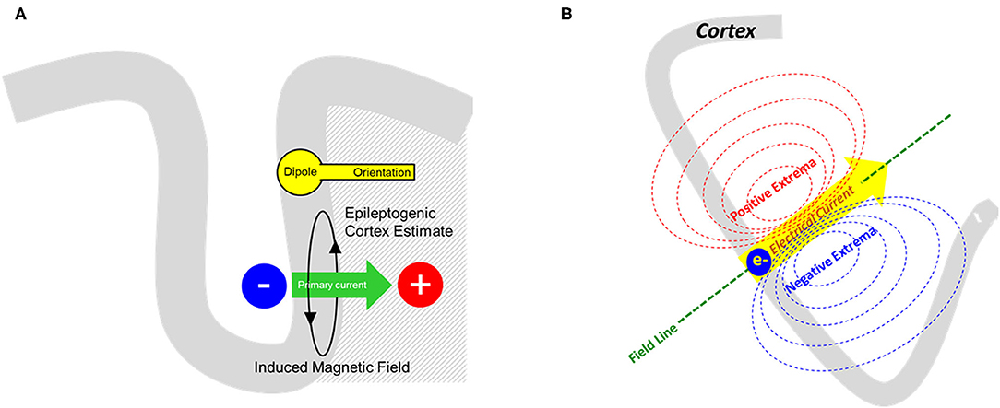
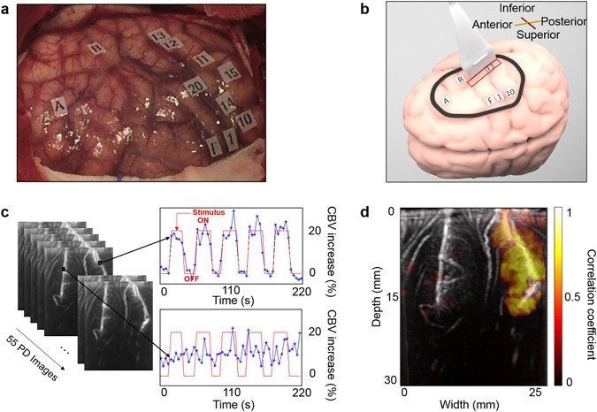
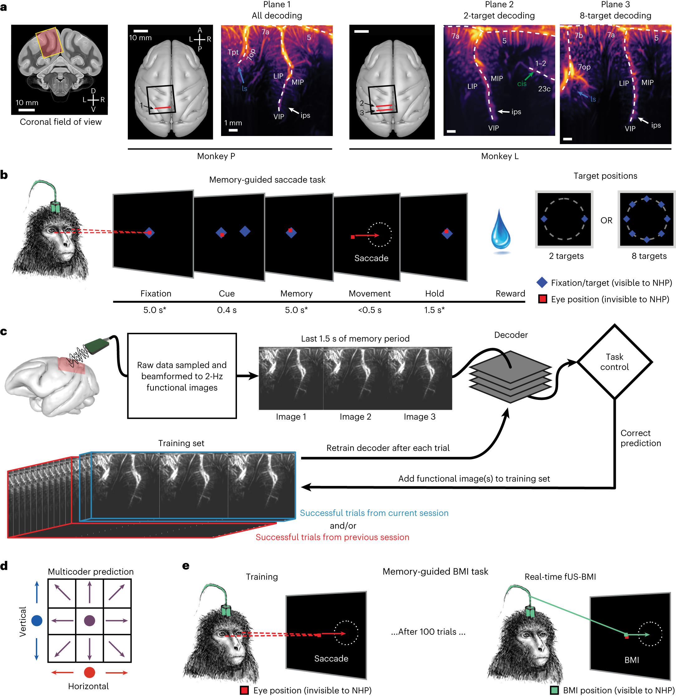
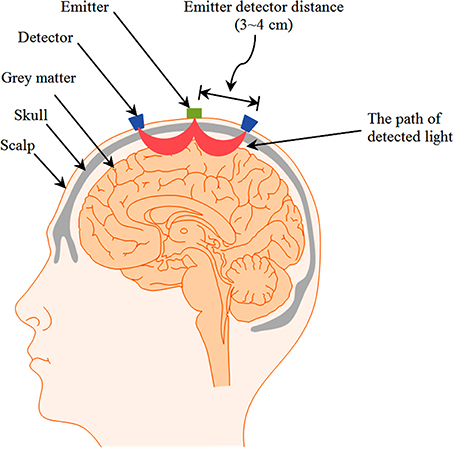

> 图 1–5 是可以按 CC BY 转载的文献原图。液氦头盔与光泵头盔的对照照片、BOLD 的经典响应曲线，以及新生儿超声和功能磁共振沟通实验的原图，不在可转载的许可里，只给链接。第 3 讲把 EEG、MEG、fNIRS 和 fMRI 放在一张侵入程度的表里；这一篇把介质和信号拆开写，并补上超声。

脑机接口要先决定读哪一种离开头部的物理量。脑磁图读的是神经元电流的磁场。功能超声、功能性近红外光谱和功能性磁共振读的都是血管反应，只是载体分别是声波、近红外光和氢核的射频信号。载体不同，能问的问题、设备和能做的实验场所都不一样。

## 1. 先把电流和血管分开

皮层锥体细胞接受突触输入时，树突上有跨膜电流。细胞内这一段电流叫初级电流，它在细胞外组织里闭合，形成容积电流。脑电图记录的是容积电流在头皮上造成的电位。脑磁图记录的是同一组电流产生的磁场。Buzsáki、Anastassiou 与 Koch（2012）把锋电位、局部场电位、皮层脑电和头皮脑电看成同一类细胞外电流在不同距离上的样子；头外磁场大约是 10–1000 fT。

功能超声、近红外和功能磁共振不读这段电流。神经活动通过神经血管耦合改变局部血流：突触释放的谷氨酸作用于神经元和星形胶质细胞，小动脉舒张，脑血流量的增加通常超过耗氧的增加（Attwell 等，2010；Iadecola，2017）。多出来的含氧血把静脉里的脱氧血红蛋白冲稀。三套成像看到的是这个下游过程的不同侧面。

| 方法 | 直接测到的量 | 它反映的生理过程 |
| --- | --- | --- |
| 脑磁图 | 头外磁场 | 突触后电流，毫秒 |
| 功能超声 | 功率多普勒 | 运动血细胞的量，也就是脑血容量 |
| 近红外 | 光强衰减 | 氧合、脱氧血红蛋白浓度 |
| 功能磁共振 | T2\* 加权信号 | 静脉脱氧血红蛋白造成的局部磁场不均匀 |

因此后三种方法即使用很快的采样，也回答不了“这一毫秒哪一群细胞放电”。它们回答的是“接下来几秒，哪一块组织的血流和血氧变了”。

## 2. 脑磁图

### 2.1 磁场从哪一段电流来

初级电流沿着锥体细胞的顶端树突，方向垂直于皮层表面。脑回顶部的皮层平行于头皮，树突指向头皮外侧，电流是径向的。沟壁上的皮层几乎垂直于头皮，树突与头皮平行，电流是切向的。

在球形导体模型里，径向初级电流的磁场被容积电流抵消，头外测不到；切向电流的磁场伸出头外（Hämäläinen 等，1993）。真实头颅只是接近球形，径向源不是绝对为零，但灵敏度仍然低得多。中央沟前壁上有很大一部分手部运动皮层，细胞在这里排成切向，所以运动想象的 μ、β 节律是脑磁图能稳定看到的一类信号。深部核团距离远，磁场掉得快，丘脑和基底节不是这套方法的长处。

*图 1. Laohathai 等（2021）图 1。A：致痫皮层上的偶极子朝向、初级电流，以及初级电流感应出的磁场。B：电流方向与磁力线，以及头外的正、负极值。这是临床定位用的偶极子图，不是脑回径向源和沟壁切向源的对照。许可：CC BY。[10.3389/fneur.2021.722986](https://doi.org/10.3389/fneur.2021.722986)*

从头外磁场反推皮层电流是欠定的。同一种传感器读数可以对应很多种电流分布，定位必须加上源的稀疏性、皮层朝向或波束形成这一类先验。Baillet（2017）把这件事写成脑磁图的基本限制：时间分辨率是电生理的，空间分辨率取决于信噪比、源的深度和逆问题怎么解，不能把传感器间距直接当成定位精度。

头外常见的 10–1000 fT，和地磁场大约 50 μT 相比，大约小了几千万到几十亿倍。电梯、地铁和城市里的磁噪声都比脑磁大。所以传统系统要把人和仪器放进磁屏蔽室。

### 2.2 设备：液氦头盔和光泵磁强计

Cohen（1968）先在屏蔽室里用感应线圈记录到 α 节律的磁场。Cohen（1972）改用超导量子干涉器件（SQUID）之后，脑磁图才成为可重复的测量。SQUID 基于约瑟夫森结，工作在液氦温度 4.2 K。拾取线圈放在杜瓦瓶底部，距离头皮常常还有数厘米。均匀的环境场用梯度计抑制：远处的噪声在两个线圈上几乎一样，相减之后留下靠近头皮的脑磁场。

全头临床系统有两条常见硬件路线。Neuromag / MEGIN 这一路是 306 通道，其中 102 个磁强计、204 个平面梯度计。CTF 全头系统常用 275 通道轴向梯度计。头盔是固定的，头相对于线圈移动就会把空间信息弄乱，所以记录时要求尽量不动。

光泵磁强计（OPM）把传感器从液氦里拿出来。碱金属蒸气被激光极化，在接近零场的自旋交换弛豫自由区工作，室温就能达到接近 SQUID 的灵敏度（Tierney 等，2019；Brookes 等，2022）。传感器可以贴在头皮上，距离短，信号大，头盔也能跟着头转。限制同样明确：这种传感器的动态范围很小，环境磁场必须先被屏蔽室和主动补偿线圈压到接近零。Boto 等（2018）的可穿戴系统是在屏蔽室内完成的，被试可以点头、伸懒腰、喝水和抛接球，不是走到街上去记录。Brookes 等（2022）图 2 把液氦杜瓦里的 SQUID 头盔和贴头皮的光泵头盔放在一起，该文为 CC BY，照片不转载到这里：[10.1016/j.tins.2022.05.008](https://doi.org/10.1016/j.tins.2022.05.008)。

### 2.3 已经做成的应用

临床里，脑磁图用于癫痫样放电的定位，以及手术前确定感觉运动和语言皮层（Baillet，2017）。它没有电离辐射，时间分辨率够看棘波的传播，空间上又比头皮脑电更少受颅骨导电不均匀的影响。代价是设备和屏蔽室，检查不能在床旁做。

脑机接口的人体证据还在实验室规模。Mellinger 等（2007）让 6 名被试用肢体运动想象调节感觉运动区的 μ 节律和 β 节律，在传统全头系统里做二选一。反馈训练大约 32 分钟后，μ 节律的自主控制达到显著。这是内源性控制，不依赖外部闪烁刺激，和瘫痪者可能用得上的运动想象是同一类任务。样本只有 6 人，没有变成临床沟通设备。

Wittevrongel 等（2021）把光泵磁强计接到在线拼写。目标按伪随机顺序放大、缩小，诱发出的是瞬态视觉磁场，不是固定频率的稳态闪烁。3 名健康被试的平均正确率 97.7%。这个正确率建立在注视或注意目标上，属于依赖刺激的接口。眼睛和注意都不能用的完全闭锁状态，这套范式接不上。它证明的是光泵传感器可以做单试次、实时的解码，不是已经有了一台可带回家的沟通器。

*图 2. Wittevrongel 等（2021）图 1。A：提示出现后隐藏，各目标以 150 ms 量级的间隔随机放大、缩小。B–E：光泵磁强计和脑电上，目标与非目标的波形及地形图。F、G：磁强计、梯度计和脑电的正确率随刺激重复次数上升。许可：CC BY。[10.1186/s12915-021-01073-6](https://doi.org/10.1186/s12915-021-01073-6)*

Défossez 等（2023）用对比学习，把脑磁或脑电对齐到语音自监督模型的表示上，解码的是被试正在听的语音。3 秒脑磁信号从一千个以上的语音片段里找出对应片段，最高可以到 41% 的首位命中。这是感知解码，被试没有说话，也没有在想象说话。它说明非侵入磁场里有词汇和语义信息，离“把想说的话写出来”还有任务和人群两层差别。

## 3. 超声：聚焦线扫、功能超声、治疗性聚焦

“聚焦超声”在中文里常被用来指治疗。成像里也有聚焦，但功能和治疗用的序列、声强和读出量不同。这一节把三件事分开。

### 3.1 声波看到的是血，不是神经元

软组织里的声速大约 1540 m/s。频率和波长成反比：

$$
\lambda = c / f
$$

15 MHz 时波长大约 0.1 mm，和后面猕猴实验里 100 μm 的面内分辨率是同一量级。频率越高，分辨越细，颅骨的衰减和像差也越重。成人完整颅骨对 15 MHz 几乎是一堵墙。临床经颅多普勒看 Willis 环附近的大血管，走的是颞骨较薄的声窗，频率大约 1–2 MHz，空间尺度是毫米级的大血管，不是皮层微循环。

超声图像来自回波。组织界面给出结构。血细胞在运动，回波频率发生多普勒偏移。常规彩色多普勒估计的是速度。功能超声用的是另一项：去掉组织杂波之后，把多普勒频谱的功率积分起来。这个功率正比于体素里正在运动的血量，所以读的是脑血容量，不是神经元的机械振动（Macé 等，2011）。

血容量为什么会随任务变，又回到第 1 节的神经血管耦合。图像可以每秒刷新 1–2 次，被刷新的那个生理量仍然要数秒才起来。

### 3.2 三种用法

常规 B 超是聚焦线扫。探头逐线聚焦，一行扫完再扫下一行。一个几厘米的平面扫完，帧率不够把微血管里很慢的血流采够样本，所以长期只能看大血管。

功能超声改成平面波。一次发射照亮整个切面，再用多个小倾角的平面波复合，帧率到千赫，慢血流才有足够的采样（Macé 等，2011）。Griggs 等（2023）的在线实验用 15.6 MHz、11 个倾角（−6° 到 6°）、脉冲重复频率 5500 Hz，复合之后每秒输出 2 帧功率多普勒图。视野大约宽 12.8 mm、深 16 mm，层厚约 400 μm，面内 100 μm × 100 μm。

治疗性聚焦超声把能量汇到一个小焦点。低强度、低占空比的经颅聚焦超声可以调制人的初级体感皮层（Legon 等，2014）。高强度聚焦超声用于消融。这两件事的输出是力、热或空化，输入端要控制的是声强和焦点位置。它们不是血流图像。Rabut 等（2020）把“用超声看神经活动”和“用超声改神经活动”放在同一篇综述里，正是因为硬件都叫超声，生理上却是读和写两条线。

超快超声还可以再往前走一步。超声定位显微用微量气泡做点状散射体，突破衍射极限，把血管画到几十微米以下（Errico 等，2015）。它要注射造影剂，帧率也从“血容量随时间变化”换成“一段时间内把气泡轨迹积起来”。这是血管结构的超分辨，不是现在这套脑机接口用的功率多普勒。

### 3.3 设备和声窗

*图 3. Imbault 等（2017）图 1。a：开颅后皮层表面的电刺激标签。b：探头放在脑表面，红框是成像平面。c：功率多普勒图和刺激开、关时脑血容量的升降。d：血容量变化与刺激的相关图，相关高的区域落在切面的一侧。许可：CC BY。[10.1038/s41598-017-06474-8](https://doi.org/10.1038/s41598-017-06474-8)*

研究系统多用可编程超声仪，Griggs 等用的是 256 通道的 Verasonics Vantage，实时功率多普勒软件来自 Inserm 与 Iconeus。探头是小型化线阵，猕猴实验里约 15–16 MHz。经囟门的新生儿探头要软、要能贴在头皮上，频率和孔径按囟门的大小来。

声窗决定侵入程度，不能把“超声”三个字直接写成非侵入。

- 新生儿囟门未闭。Demene 等（2017）把柔性探头放在头皮上，和视频脑电同时记录。功率多普勒的空间尺度约 200 μm。他们看到睡眠状态对应的血容量变化，并在两名皮层发育异常的新生儿里追踪癫痫发作时血容量变化的传播。这是人身上真正无创的功能超声，场所是新生儿重症监护，不是成人脑机接口。
- 成人完整颅骨。Errico 等（2016）在大鼠上用微泡增强，隔着颅骨做成了功能超声。啮齿类颅骨薄。人的颞窗能透过低频多普勒，15 MHz 的皮层功能成像还没有变成常规无创检查。
- 骨窗或开颅。Imbault 等（2017）在开颅手术中把探头放在人的脑表面，记录功能活动。Norman 等（2021）和 Griggs 等（2023）的猕猴实验先做颅骨切开，探头放在硬膜外，硬膜不打开。按电极的标准，这是硬膜外、微创开口；按“探头放在头皮上”的标准，它还不是非侵入。

### 3.4 脑机接口做到了哪一步

Norman 等（2021）在后顶叶皮层做离线单试次解码。顶内沟的外侧壁和内侧壁可以落在同一张冠状切面里，分别和眼动计划、伸手计划有关。他们解出左右方向、手或眼这两种效应器，以及是否执行。成像参数是 15 MHz，功率多普勒约 1 Hz，面内 100 μm，视野与后来的在线实验相近。

*图 4. Griggs 等（2023）图 1。a：两只猕猴的冠状视野，以及两方向、八方向解码用的成像平面，图上标出 LIP、MIP、VIP。b：记忆导向眼跳，目标在提示后消失，眼跳发生在记忆期之后。c：原始回波波束形成为 2 Hz 的功能图像，成功试次再送回去重训解码器。d、e：八方向分成水平、垂直分量，训练之后屏幕上的反馈改由解码位置驱动。许可：CC BY。[10.1038/s41593-023-01500-7](https://doi.org/10.1038/s41593-023-01500-7)*

Griggs 等（2023）把同一条路线做成闭环。两只猕猴，探头在硬膜外，后顶叶，2 Hz 的功能超声送进线性解码器。先做两方向的记忆导向眼跳，再做到八个方向。八方向的机会水平是 12.5%。文中一个没有预训练的例子在训练后平台到 34%–37%，错误大多落在相邻方向，平均角度误差降到约 45°。用 42 天前的数据做预训练的另一个例子，累计正确率到 45%，平均角度误差约 34°。两只动物差得很远：八方向的平均角度误差，一只大约 38°–45°，另一只大约 71°–75°。伸手方向也可以在同一张切面里解，因为切面同时盖住与眼动有关的外侧顶内区和与伸手有关的内侧顶内区。

这些数字说明血容量图像里有运动计划，而且血管模式可以跨天对齐，不必像刺入式电极那样每天重新找同一批神经元。它们也说明：样本是两只动物，颅骨是打开的，八方向还远不到运动假体需要的带宽。成人经完整颅骨的超声脑机接口，目前没有对应的人体闭环实验。

## 4. 功能性近红外光谱

### 4.1 光学窗和两种血红蛋白

生物组织对可见光散射和吸收都很强。大约 650–900 nm 这一段，水的吸收相对较低，近红外可以进到头皮以下，这就是 Jöbsis（1977）用来无创观察组织氧合的窗口。散射仍然占主导，光子在组织里走折线，从光源到探测器的路径像一根香蕉。

氧合血红蛋白（HbO）和脱氧血红蛋白（HbR）的摩尔消光系数不同，两条曲线大约在 800 nm 附近交叉。交叉点短波一侧 HbR 吸收更高，长波一侧 HbO 吸收更高。连续波系统因此至少用两个波长，才能把总的光强变化拆成两种浓度。数值表用 Oregon Medical Laser Center 汇编的血红蛋白消光系数（[omlc.org/spectra/hemoglobin](https://omlc.org/spectra/hemoglobin/)）。下面这张文献图只画光子路径，不画消光曲线，也不画连续波、频域、时域三种仪器。

浓度变化用修正的比尔–朗伯定律。Delpy 等（1988）用时间分辨测量说明，光子实际走的路比光源到探测器的直线距离长，这个倍数就是差分路径因子（DPF）：

$$
\Delta A(\lambda)=\big(\varepsilon_{\mathrm{HbO}}(\lambda)\,\Delta c_{\mathrm{HbO}}+\varepsilon_{\mathrm{HbR}}(\lambda)\,\Delta c_{\mathrm{HbR}}\big)\,d\,\mathrm{DPF}(\lambda)
$$

$\Delta A$ 是光密度变化，$\varepsilon$ 是摩尔消光系数，$d$ 是光源—探测器间距。成人头上的 DPF 常常在 6 左右，并且随部位、年龄和波长变化，不能拿一个常数用到所有通道（Scholkmann 等，2014）。公式还假设这段时间里散射没有明显变化。慢的血氧信号大体满足；毫秒级的散射变化虽然有人报告过，并不是现在近红外脑机接口在用的那个信号。

激活之后的典型方向和“大脑用了氧，所以氧合血红蛋白下降”相反。局部血流增加超过耗氧，HbO 上升，HbR 下降，峰值常在任务开始后 5–8 秒（Villringer 与 Chance，1997；Coyle 等，2004）。

间距约 3 cm 时，路径最深的部分大约在 1.5 cm，也就是外层皮层。灵敏度曲线偏向浅层，多数光子仍走在头皮里。头发、头动、心跳、呼吸和大约 0.1 Hz 的 Mayer 波都会进到信号里。间距约 5–10 mm 的短通道主要采样头皮，可以用来回归这层干扰（Gagnon 等，2012）。深部核团不在光子能到的深度里。

*图 5. Naseer 与 Hong（2015）图 2。光源与探测器相距约 3–4 cm，被检测到的光在头皮、颅骨之下弯进灰质再返回。许可：CC BY。[10.3389/fnhum.2015.00003](https://doi.org/10.3389/fnhum.2015.00003)*

### 4.2 三种仪器

连续波只测光强。光源是发光二极管或激光二极管，探测器是光电二极管或雪崩光电二极管。脑机接口和可穿戴认知实验大多是这一类。日立、岛津、NIRx、Artinis 都有头戴式或整机式的连续波系统。通道可以少到运动区上的一对光源—探测器，也可以密到几十上百个，用来做漫射光学断层成像。Eggebrecht 等（2014）用高密度探头和断层重建，把分布式皮层网络画出来。那已经是成像，不只是几个光极的曲线。

频域把光强调制到大约 100 MHz，同时测幅度和相位。相位给出光子的平均飞行时间，路径长度不用全部押在一个文献 DPF 上。

时域发射皮秒脉冲，按光子到达时间分开浅层和深层。晚到的光子走过更深的组织。Ban 等（2022）报告的 Kernel Flow 是可穿戴的时域系统，说明这条路线已经离开光学平台。时域的硬件和标定比连续波重，脑机接口的人体研究仍以连续波为主。

Pinti 等（2020）综述了近红外走出实验室之后的用法：走路、对话和自然场景里可以戴着记，代价是运动伪迹和头皮血流更难控。Ferrari 与 Quaresima（2012）则把仪器史从床旁组织氧合记到认知实验。临床近红外还有另一条线，是新生儿和术中的脑氧饱和度监测。那是几个光极的趋势监护，不是时空成像，也不等于脑机接口。

### 4.3 脑机接口里怎么用

Coyle、Ward、Markham 与 McDarby（2004）把一对光极放在 10–20 系统的 C3，波长 700 nm 和 880 nm，平均光功率低于 2 mW/mm²。被试实际握球或想象握球，HbO 上升、HbR 下降。他们用大约 20 秒的窗做休息和激活的切换，信息传输率约 3 bit/min；若按 5 秒上升、5 秒回到基线来估算，单通道有可能到约 6 bit/min。离线、跨被试平均之后的正确率是 75%。这是单通道、健康人、早期可行性，不是沟通速率。

Naseer 与 Hong（2015）综述了此后的任务：运动皮层上用运动想象，前额没有头发，适合心算、音乐想象和情绪诱导。分类多用线性判别。前额任务对不能做运动想象的人有用，也更容易混进全身血流和情绪引起的头皮变化。

脑电有毫秒级时间、对电噪声敏感；近红外对电噪声不敏感、时间慢、对头皮血流敏感。Fazli 等（2012）把两者合在一个分类器里，正确率高于单独使用其中任何一种。混合接口现在是这条路线上比较实际的做法：用脑电抓时间，用近红外确认那一块浅表皮层的血氧是不是跟着变了。

## 5. 功能性磁共振

### 5.1 为什么激活区会变亮

氢核在静磁场 $B_0$ 里进动，频率是

$$
f_0 = \frac{\gamma}{2\pi} B_0 \approx 42.6\,\mathrm{MHz/T}\times B_0
$$

3 T 大约是 127.7 MHz。射频脉冲把磁化扳离平衡，接收线圈记下它回到平衡的过程。结构像多用 T1 对比。功能像常用梯度回波，对比度是 T2\*：局部磁场越不均匀，信号掉得越快。

脱氧血红蛋白是顺磁的，氧合血红蛋白是抗磁的。Ogawa 等（1990）在高场动物图像里看到，血管里的脱氧血红蛋白本身就能造成对比，不用外源造影剂。人的感觉刺激实验随后确认，激活区的梯度回波信号是升高的（Kwong 等，1992；Ogawa 等，1992）。原因就是第 1 节那条链：血流增加超过耗氧，静脉脱氧血红蛋白下降，局部磁场更均匀，T2\* 变长，图像变亮。这个上升叫血氧水平依赖信号（BOLD）。

强的感觉激活在 3 T 上常常只有百分之一到几个百分点。它不是“神经元亮了”，是静脉血的磁性质变了一点。

Logothetis 等（2001）在猴的视觉皮层同时记录电生理和 BOLD，发现 BOLD 与局部场电位的相关紧于多单元锋电位。局部场电位更接近突触输入和局部处理，锋电位是细胞的输出。所以功能磁共振回答的问题，靠近第 3 讲里的场电位，而不是单细胞发放。Logothetis（2008）把由此而来的限度写得很直接：一个体素里的上升不能单独证明那一群细胞在发放，也不能单独证明心理状态。

典型响应在短暂刺激后 4–6 秒到峰值，15–20 秒回到基线附近，后面可以有一个小的负向欠冲。SPM 常用的双伽马核把主响应参数放在 6 秒、欠冲参数放在 16 秒、幅度比放在 6，算出来的峰值约在 4.9 秒，欠冲大约是峰值的十分之一。这是模型，不是某一位受试者的曲线；Ogawa、Kwong 和 Logothetis 的实验原图不在可转载许可里，这里不嵌。脑区、年龄和血管状态会把峰值移动几秒。有人报告过更早的“初始下降”，幅度小，也不稳定，脑机接口不用它做特征。

### 5.2 磁体、线圈和序列

临床主力是 1.5 T 和 3 T 的超导磁体。梯度线圈做空间编码，头线圈接收。功能像的工作序列是梯度回波平面成像：一次激发采集一整层。常规全脑体素常常是 2–3 mm。多层同时采集可以把全脑重复时间压到大约 1 秒。7 T 把信噪比和血管敏感性再提高，专门的序列可以做到亚毫米、看皮层分层。检查更长，伪影和禁忌也更严。

安全约束来自三个场。静磁场会把铁磁物体吸进磁体孔。射频沉积热量，全身和局部有比吸收率的限值。梯度切换既可能刺激外周神经，也会产生很大的噪声，检查时要做听力防护。心脏起搏器和很多植入物要按具体场强和厂商条件判断能不能进。幽闭和任务能否在磁体里完成，是脑机接口场景里同样硬的限制。

### 5.3 已经做成的应用

认知神经科学用它做全脑定位，神经外科用它做手术前的功能定位。这些不是脑机接口，但解释了为什么它的空间优势在全脑，包括近红外和脑磁图都弱的深部。

沟通实验用的是心理任务对 BOLD 空间模式的控制。Owen 等（2006）请一名符合植物状态临床标准的患者想象打网球或在家里行走。辅助运动区和顶叶的活动和健康人做同样想象时一致。Monti 等（2010）把这件事扩到 54 名意识障碍患者，其中植物状态 23 名、最小意识状态 31 名。5 人能够按指令调制脑活动；临床床旁检查在其中 2 人身上没有看到自主行为。1 人在扫描仪里用两种想象回答是非题，床旁仍然建立不了沟通。

健康人身上，实时功能磁共振可以把字母编进心理任务的种类、开始时间和持续时间。Sorger、Reithler、Dahmen 与 Goebel（2012）用这套编码在线选择 27 个字符。血流动力学决定了速率：一个选择要占住数秒到十几秒，做不到说话的带宽。Sitaram 等（2017）综述的神经反馈是另一类用途。被试看着自己某个脑区的 BOLD，学习把活动拉高或压低，目标是训练而不是每个试次传一个字母。

Tang、LeBel、Jain 与 Huth（2023）用编码—解码模型，从连续语言的功能磁共振里重建语义。被试听故事时，解码出的词序列在意思上接近原文。论文也测试了想象语言。血氧信号把好几秒里的词混在同一个体积里，所以这是语义重建，不是按词对齐的听写。它和 Défossez 等（2023）的脑磁感知解码正好互补：功能磁共振空间覆盖全脑、时间被血管抹平；脑磁图时间够细、空间停在皮层电流的逆问题。

## 6. 放在同一张表里

| | 脑磁图 | 功能超声 | 近红外 | 功能磁共振 |
| --- | --- | --- | --- | --- |
| 介质 | 磁场 | 兆赫声波 | 650–900 nm 光 | 静磁场中的氢核与射频 |
| 信号 | 头外 10–1000 fT | 功率多普勒，脑血容量 | HbO、HbR | 静脉脱氧血红蛋白对 T2\* 的影响 |
| 和神经活动的距离 | 突触后电流 | 神经血管耦合 | 神经血管耦合 | 神经血管耦合 |
| 时间 | 毫秒 | 图像 1–2 Hz，生理响应为秒 | 峰值约 5–8 秒 | 扫描可到约 1 秒，峰值约 4–6 秒 |
| 空间 | 皮层切向源；逆问题 | 有声窗时面内约 100 μm | 厘米级，外层皮层 | 全脑，常规 2–3 mm；7 T 可到亚毫米 |
| 人身上是否无创 | 是 | 新生儿经囟门是；成人高分辨率功能超声目前不是 | 是 | 是 |
| 脑机接口的人体或动物证据 | 6 人的运动想象；3 人的视觉拼写 | 2 只猕猴，硬膜外，在线最多八方向 | 人的运动想象和前额认知任务，可穿戴 | 意识障碍患者的是非；健康人拼写、反馈和语义重建 |
| 主要丢掉的信息 | 径向源和深部 | 完整成人颅骨后面的皮层 | 深部，以及被头皮血流混杂的细节 | 毫秒级的放电时序 |

选择按问题来，不按一张总排名来。

要毫秒级的皮层电流，并且源大体在沟壁上，用脑磁图。要全脑、包括深部结构的血氧定位，用功能磁共振。要在病房或日常环境里看外层皮层的血氧，并且可以和脑电戴在一起，用近红外。要在有声窗的时候看 100 μm 量级的血容量，功能超声的空间尺度是这四者里最细的；成人若没有囟门或骨窗，这个尺度目前到不了。

四者都还没有接近刺入式电极在运动和语言假体上的带宽。血管信号被神经血管耦合限速。脑磁图虽然是电生理，头外磁场经过容积导体和逆问题之后，单试次能稳定解出的自由度仍然少。第 3 讲里的皮层内电极读的是另一类信号。

## 7. 已经嵌入的图，和仍然只给链接的图

图 1–5 来自原文，许可都是 CC BY：

- 图 1：Laohathai 等（2021）图 1，临床偶极子与初级电流。
- 图 2：Wittevrongel 等（2021）图 1，光泵磁强计的在线视觉拼写。
- 图 3：Imbault 等（2017）图 1，人术中功能超声。
- 图 4：Griggs 等（2023）图 1，猕猴闭环超声脑机接口。
- 图 5：Naseer 与 Hong（2015）图 2，近红外的光子路径。

下面几张没有嵌进页面。Brookes 等（2022）图 2 是 CC BY，比较液氦头盔和光泵头盔，图片文件没有放进本文：[10.1016/j.tins.2022.05.008](https://doi.org/10.1016/j.tins.2022.05.008)。Ban 等（2022）的可穿戴时域近红外见 [10.1117/1.JBO.27.7.074710](https://doi.org/10.1117/1.JBO.27.7.074710)。新生儿功能超声的原图在 Demene 等（2017），功能磁共振沟通实验的原图在 Owen 等（2006）、Monti 等（2010）和 Sorger 等（2012）。这些期刊图没有放进本文。

## 参考文献

- Attwell, D., Buchan, A. M., Charpak, S., Lauritzen, M., MacVicar, B. A., & Newman, E. A. (2010). Glial and neuronal control of brain blood flow. *Nature, 468*(7321), 232–243. https://doi.org/10.1038/nature09613
- Baillet, S. (2017). Magnetoencephalography for brain electrophysiology and imaging. *Nature Neuroscience, 20*(3), 327–339. https://doi.org/10.1038/nn.4504
- Ban, H. Y., et al. (2022). Kernel Flow: A high channel count scalable time-domain functional near-infrared spectroscopy system. *Journal of Biomedical Optics, 27*(7), 074710. https://doi.org/10.1117/1.JBO.27.7.074710
- Boto, E., et al. (2018). Moving magnetoencephalography towards real-world applications with a wearable system. *Nature, 555*(7698), 657–661. https://doi.org/10.1038/nature26147
- Brookes, M. J., Leggett, J., Rea, M., Hill, R. M., Holmes, N., Boto, E., & Bowtell, R. (2022). Magnetoencephalography with optically pumped magnetometers (OPM-MEG): The next generation of functional neuroimaging. *Trends in Neurosciences, 45*(8), 621–634. https://doi.org/10.1016/j.tins.2022.05.008
- Buzsáki, G., Anastassiou, C. A., & Koch, C. (2012). The origin of extracellular fields and currents — EEG, ECoG, LFP and spikes. *Nature Reviews Neuroscience, 13*(6), 407–420. https://doi.org/10.1038/nrn3241
- Cohen, D. (1968). Magnetoencephalography: Evidence of magnetic fields produced by alpha-rhythm currents. *Science, 161*(3843), 784–786. https://doi.org/10.1126/science.161.3843.784
- Cohen, D. (1972). Magnetoencephalography: Detection of the brain's electrical activity with a superconducting magnetometer. *Science, 175*(4022), 664–666. https://doi.org/10.1126/science.175.4022.664
- Coyle, S., Ward, T., Markham, C., & McDarby, G. (2004). On the suitability of near-infrared (NIR) systems for next-generation brain–computer interfaces. *Physiological Measurement, 25*(4), 815–822. https://doi.org/10.1088/0967-3334/25/4/003
- Défossez, A., et al. (2023). Decoding speech perception from non-invasive brain recordings. *Nature Machine Intelligence, 5*(10), 1097–1107. https://doi.org/10.1038/s42256-023-00714-5
- Delpy, D. T., et al. (1988). Estimation of optical pathlength through tissue from direct time of flight measurement. *Physics in Medicine and Biology, 33*(12), 1433–1442. https://doi.org/10.1088/0031-9155/33/12/008
- Demene, C., et al. (2017). Functional ultrasound imaging of brain activity in human newborns. *Science Translational Medicine, 9*(411), eaah6756. https://doi.org/10.1126/scitranslmed.aah6756
- Eggebrecht, A. T., et al. (2014). Mapping distributed brain function and networks with diffuse optical tomography. *Nature Photonics, 8*(6), 448–454. https://doi.org/10.1038/nphoton.2014.107
- Errico, C., et al. (2015). Ultrafast ultrasound localization microscopy for deep super-resolution vascular imaging. *Nature, 527*(7579), 499–502. https://doi.org/10.1038/nature16066
- Errico, C., et al. (2016). Transcranial functional ultrasound imaging of the brain using microbubble-enhanced ultrasensitive Doppler. *NeuroImage, 124*, 752–761. https://doi.org/10.1016/j.neuroimage.2015.09.037
- Fazli, S., et al. (2012). Enhanced performance by a hybrid NIRS–EEG brain computer interface. *NeuroImage, 59*(1), 519–529. https://doi.org/10.1016/j.neuroimage.2011.07.084
- Ferrari, M., & Quaresima, V. (2012). A brief review on the history of human functional near-infrared spectroscopy (fNIRS) development and fields of application. *NeuroImage, 63*(2), 921–935. https://doi.org/10.1016/j.neuroimage.2012.03.049
- Gagnon, L., et al. (2012). Short separation channel location impacts the performance of short channel regression in NIRS. *NeuroImage, 59*(3), 2518–2528. https://doi.org/10.1016/j.neuroimage.2011.08.095
- Griggs, W. S., et al. (2023). Decoding motor plans using a closed-loop ultrasonic brain–machine interface. *Nature Neuroscience, 27*(1), 196–207. https://doi.org/10.1038/s41593-023-01500-7
- Hämäläinen, M., Hari, R., Ilmoniemi, R. J., Knuutila, J., & Lounasmaa, O. V. (1993). Magnetoencephalography—theory, instrumentation, and applications to noninvasive studies of the working human brain. *Reviews of Modern Physics, 65*(2), 413–497. https://doi.org/10.1103/RevModPhys.65.413
- Iadecola, C. (2017). The neurovascular unit coming of age: A journey through neurovascular coupling in health and disease. *Neuron, 96*(1), 17–42. https://doi.org/10.1016/j.neuron.2017.07.030
- Imbault, M., et al. (2017). Intraoperative functional ultrasound imaging of human brain activity. *Scientific Reports, 7*, 7304. https://doi.org/10.1038/s41598-017-06474-8
- Jöbsis, F. F. (1977). Noninvasive, infrared monitoring of cerebral and myocardial oxygen sufficiency and circulatory parameters. *Science, 198*(4323), 1264–1267. https://doi.org/10.1126/science.929199
- Kwong, K. K., et al. (1992). Dynamic magnetic resonance imaging of human brain activity during primary sensory stimulation. *Proceedings of the National Academy of Sciences, 89*(12), 5675–5679. https://doi.org/10.1073/pnas.89.12.5675
- Laohathai, C., Ebersole, J. S., Mosher, J. C., Bagić, A. I., Sumida, A., Von Allmen, G., & Funke, M. E. (2021). Practical fundamentals of clinical MEG interpretation in epilepsy. *Frontiers in Neurology, 12*, 722986. https://doi.org/10.3389/fneur.2021.722986
- Legon, W., Sato, T. F., Opitz, A., Mueller, J., Barbour, A., Williams, A., & Tyler, W. J. (2014). Transcranial focused ultrasound modulates the activity of primary somatosensory cortex in humans. *Nature Neuroscience, 17*, 322–329. https://doi.org/10.1038/nn.3620
- Logothetis, N. K. (2008). What we can do and what we cannot do with fMRI. *Nature, 453*(7197), 869–878. https://doi.org/10.1038/nature06976
- Logothetis, N. K., et al. (2001). Neurophysiological investigation of the basis of the fMRI signal. *Nature, 412*(6843), 150–157. https://doi.org/10.1038/35084005
- Macé, E., Montaldo, G., Cohen, I., Baulac, M., Fink, M., & Tanter, M. (2011). Functional ultrasound imaging of the brain. *Nature Methods, 8*(8), 662–664. https://doi.org/10.1038/nmeth.1641
- Mellinger, J., Schalk, G., Braun, C., Preissl, H., Rosenstiel, W., Birbaumer, N., & Kübler, A. (2007). An MEG-based brain–computer interface (BCI). *NeuroImage, 36*(3), 581–593. https://doi.org/10.1016/j.neuroimage.2007.03.019
- Monti, M. M., et al. (2010). Willful modulation of brain activity in disorders of consciousness. *The New England Journal of Medicine, 362*(7), 579–589. https://doi.org/10.1056/NEJMoa0905370
- Naseer, N., & Hong, K.-S. (2015). fNIRS-based brain-computer interfaces: A review. *Frontiers in Human Neuroscience, 9*, 3. https://doi.org/10.3389/fnhum.2015.00003
- Norman, S. L., Maresca, D., Christopoulos, V. N., Griggs, W. S., Demene, C., Tanter, M., Shapiro, M. G., & Andersen, R. A. (2021). Single-trial decoding of movement intentions using functional ultrasound neuroimaging. *Neuron, 109*(9), 1554–1566.e4. https://doi.org/10.1016/j.neuron.2021.03.003
- Ogawa, S., Lee, T. M., Kay, A. R., & Tank, D. W. (1990). Brain magnetic resonance imaging with contrast dependent on blood oxygenation. *Proceedings of the National Academy of Sciences, 87*(24), 9868–9872. https://doi.org/10.1073/pnas.87.24.9868
- Ogawa, S., et al. (1992). Intrinsic signal changes accompanying sensory stimulation: Functional brain mapping with magnetic resonance imaging. *Proceedings of the National Academy of Sciences, 89*(13), 5951–5955. https://doi.org/10.1073/pnas.89.13.5951
- Owen, A. M., et al. (2006). Detecting awareness in the vegetative state. *Science, 313*(5792), 1402. https://doi.org/10.1126/science.1130197
- Pinti, P., et al. (2020). The present and future use of functional near-infrared spectroscopy (fNIRS) for cognitive neuroscience. *Annals of the New York Academy of Sciences, 1464*(1), 5–29. https://doi.org/10.1111/nyas.13948
- Rabut, C., et al. (2020). Ultrasound technologies for imaging and modulating neural activity. *Neuron, 108*(1), 93–110. https://doi.org/10.1016/j.neuron.2020.09.003
- Scholkmann, F., et al. (2014). A review on continuous wave functional near-infrared spectroscopy and imaging instrumentation and methodology. *NeuroImage, 85*, 6–27. https://doi.org/10.1016/j.neuroimage.2013.05.004
- Sitaram, R., et al. (2017). Closed-loop brain training: The science of neurofeedback. *Nature Reviews Neuroscience, 18*(2), 86–100. https://doi.org/10.1038/nrn.2016.164
- Sorger, B., Reithler, J., Dahmen, B., & Goebel, R. (2012). A real-time fMRI-based spelling device immediately enabling robust motor-independent communication. *Current Biology, 22*(14), 1333–1338. https://doi.org/10.1016/j.cub.2012.05.022
- Tang, J., LeBel, A., Jain, S., & Huth, A. G. (2023). Semantic reconstruction of continuous language from non-invasive brain recordings. *Nature Neuroscience, 26*(5), 858–866. https://doi.org/10.1038/s41593-023-01304-9
- Tierney, T. M., et al. (2019). Optically pumped magnetometers: From quantum origins to multi-channel magnetoencephalography. *NeuroImage, 199*, 598–608. https://doi.org/10.1016/j.neuroimage.2019.05.063
- Villringer, A., & Chance, B. (1997). Non-invasive optical spectroscopy and imaging of human brain function. *Trends in Neurosciences, 20*(10), 435–442. https://doi.org/10.1016/S0166-2236(97)01132-6
- Wittevrongel, B., et al. (2021). Practical real-time MEG-based neural interfacing with optically pumped magnetometers. *BMC Biology, 19*, 158. https://doi.org/10.1186/s12915-021-01073-6
